<div align="center">

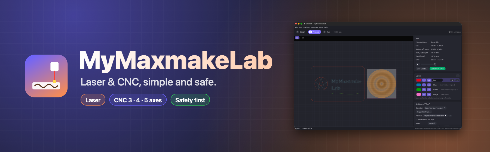

**A friendly, fast and safe laser & CNC workbench for GRBL machines.**<br>
Design · Prepare · Run — from a sketch, a photo, a font or a 3D model to a finished piece.

[](https://github.com/barracudapps/MyMaxmakeLab/releases/latest)


[](docs/MCP.md)
[](LICENSE)

**[📖 Manuel (FR)](docs/manuel/README.md)** · [Why](#why) · [Tour](#a-quick-tour) · [In 3D](#see-it-in-3d) · [Make](#what-you-can-make) ·
[Features](#features) · [Safety](#safety-first) · [Install](#install) ·
[Architecture](#architecture) · [Roadmap](#roadmap) · [Français](#-en-bref)

<br>

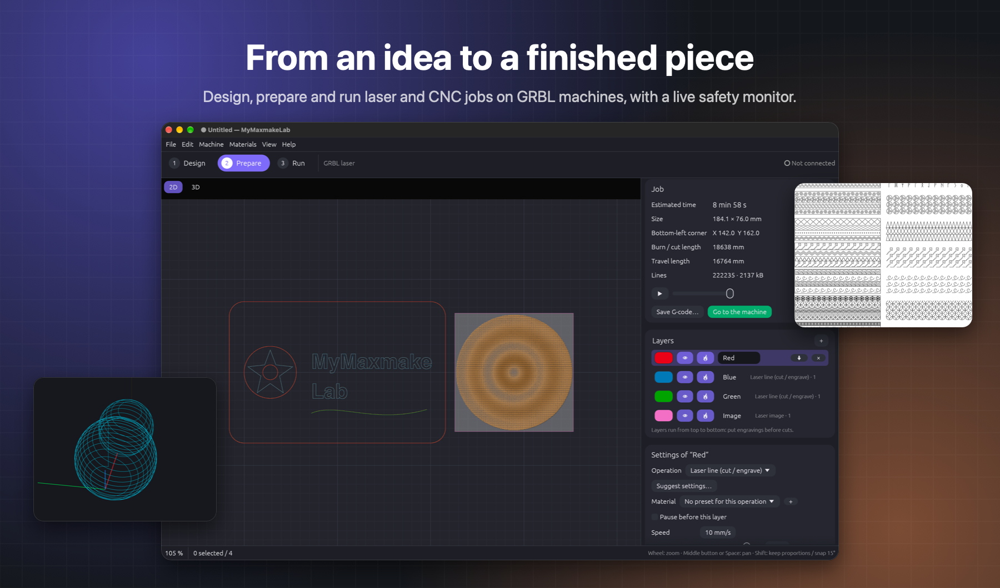

<table>
<tr>
<td width="50%">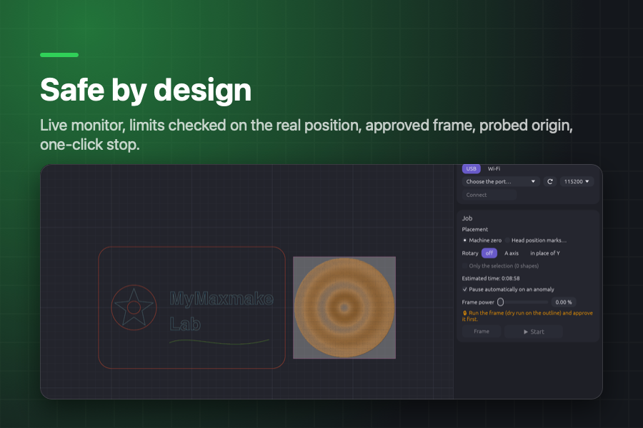</td>
<td width="50%">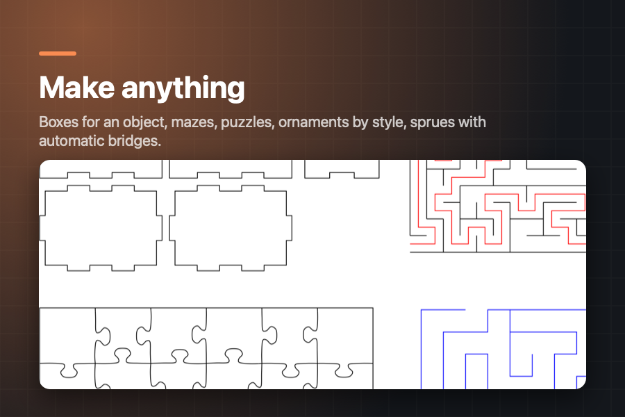</td>
</tr>
<tr>
<td>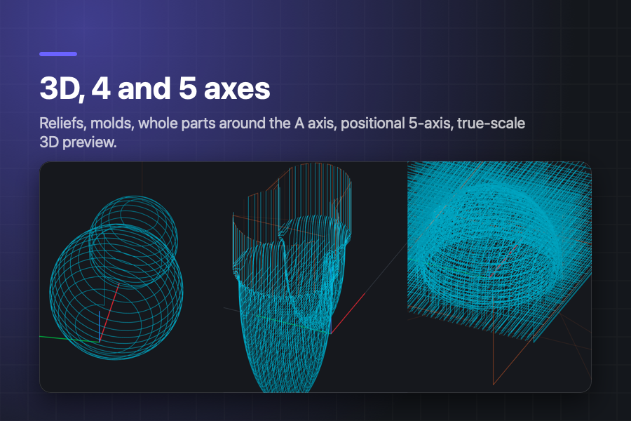</td>
<td>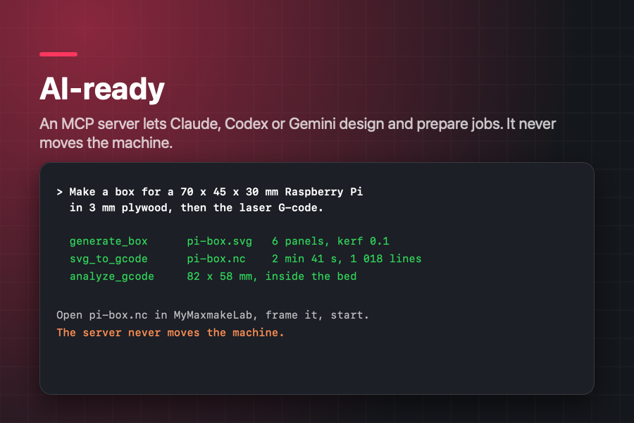</td>
</tr>
</table>

</div>

---

## Why

MyMaxmakeLab started as a rewrite of MaxmakeLAB, the vendor software of the
Marxmake HiMill and iLam machines: powerful, but heavy (320 MB of Qt), slow
to start and hard to use. It keeps every useful feature, removes friction,
and adds what operators kept asking for: safety, reproducibility and help.

| | MaxmakeLAB | MyMaxmakeLab |
|---|---|---|
| Size / start | 320 MB, Qt + OpenCV + FFmpeg | one native binary, starts instantly |
| Workflow | many modes and dialogs | 3 steps: **Design → Prepare → Run** |
| Preview | separate from the program | the exact program streamed, parsed back |
| Safety | alarm and error codes | live monitor, auto-pause, limits checked on the real position, mandatory checks |
| Reproducibility | manual | probe-before-machining, approved dry-run frame |
| G-code | relative, every word repeated | absolute, modal, up to 7× lighter |
| Help | tour dialog | start panel, settings assistant, command palette (`⌘K`), tooltips, tutorial |
| No 3D probe | manual entry only | guided hand measurement of blocks, cylinders and trapezoids |
| Homing | runs to the switches | hold-to-run, time-limited, slowed down on demand |
| Languages / themes | EN / ZH, one theme | EN / FR / DE / IT / ES, light and dark |

## A quick tour

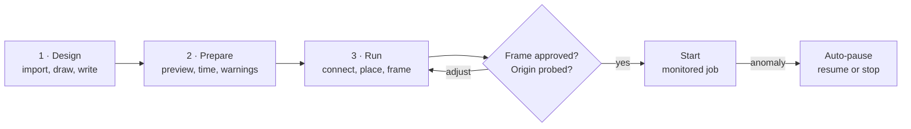

<table>
<tr>
<td width="50%"><b>Prepare</b>: the rendered burn, duration, size and warnings, updated as you tune the layers.<br></td>
<td width="50%"><b>Simulate</b>: watch the job being engraved before wasting material.<br>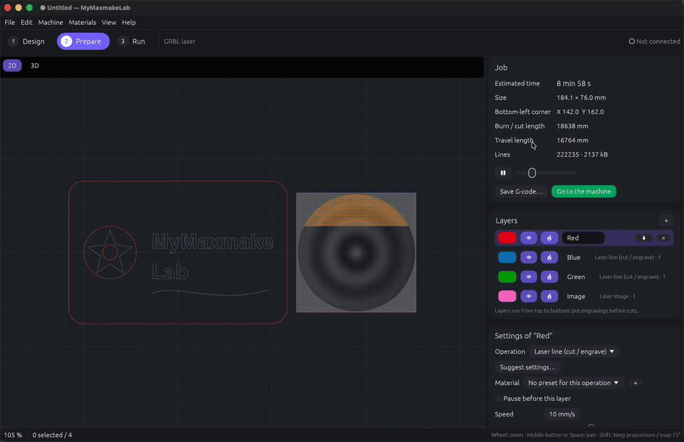</td>
</tr>
<tr>
<td><b>Run</b>: placement, rotary, checks and a Start button that is only green when it is safe.<br></td>
<td><b>3D</b>: orbit view of reliefs, multi-pass jobs and probed surfaces.<br></td>
</tr>
<tr>
<td><b>Repair and lighten</b> any G-code file, same path, fewer lines.<br>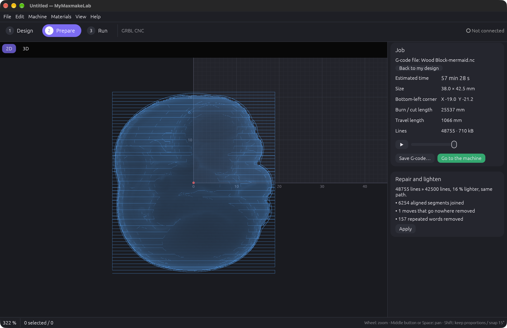</td>
<td><b>Light theme</b>: warm, rounded, readable.<br>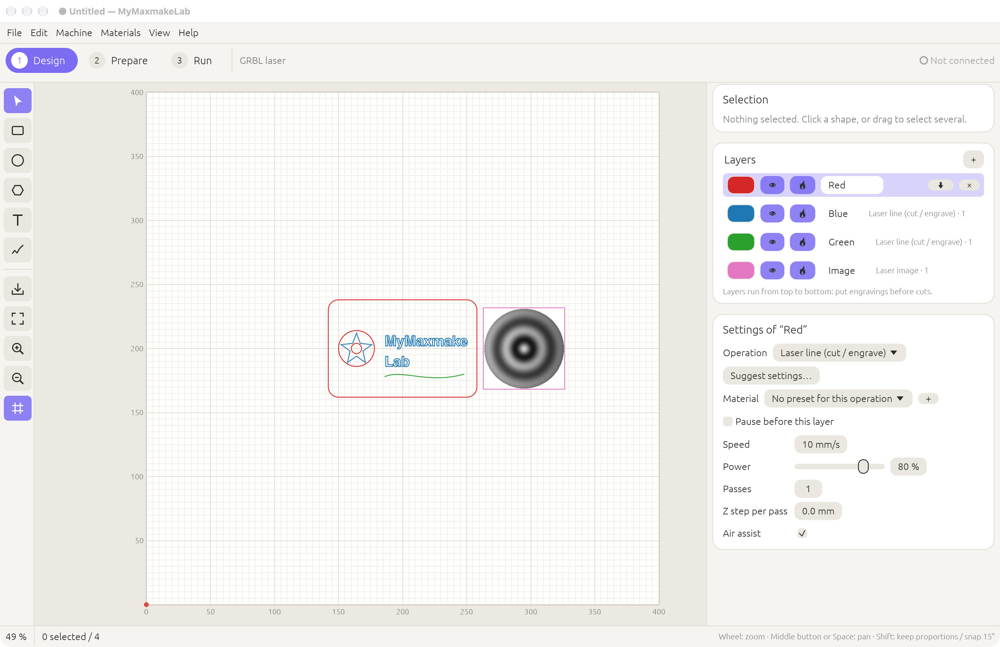</td>
</tr>
</table>

## See it in 3D

The 3D view turns around the part (**Turn** button), at true scale for
multi-axis programs.

<table>
<tr>
<td width="33%" align="center">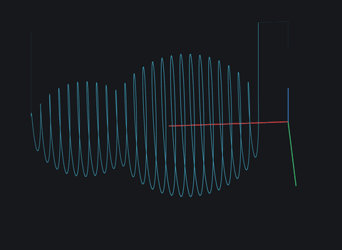<br><b>4-axis</b>: a figurine finished in one helix, the stock turning while cutting</td>
<td width="33%" align="center">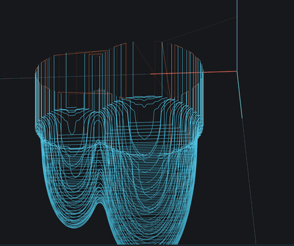<br><b>Mold</b>: the imprint of a model with an even 1 mm offset</td>
<td width="33%" align="center">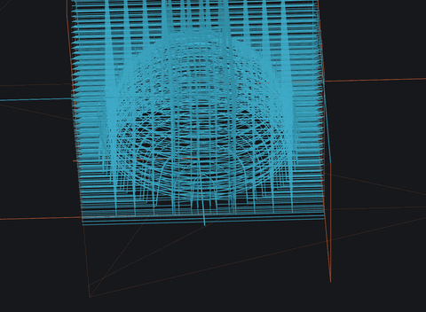<br><b>5-axis (3+2)</b>: each side of a dome turned to the tool</td>
</tr>
</table>

## What you can make

<table>
<tr>
<td width="50%">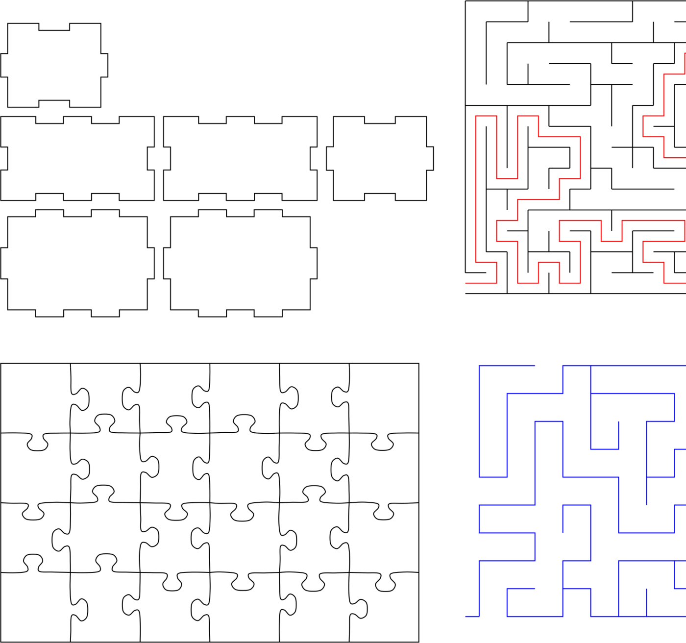<br>A <b>box</b> sized for an object, <b>mazes</b> (walls or corridors to mill, solution in red) and <b>jigsaw puzzles</b>, in one click.</td>
<td width="50%"><br><b>Ornaments by style</b>: Viking, Celtic, African, Maya, Greek, Japanese, Art Deco, Polynesian, Islamic; a new variation at each click.</td>
</tr>
<tr>
<td width="50%">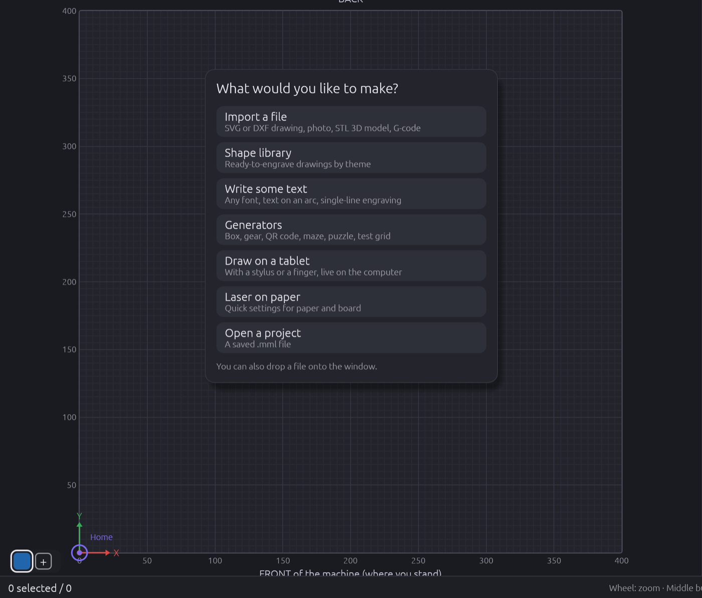<br>An empty design starts with <b>what would you like to make?</b>: import, shape library, text, generators, tablet, laser on paper, recent projects.</td>
<td width="50%">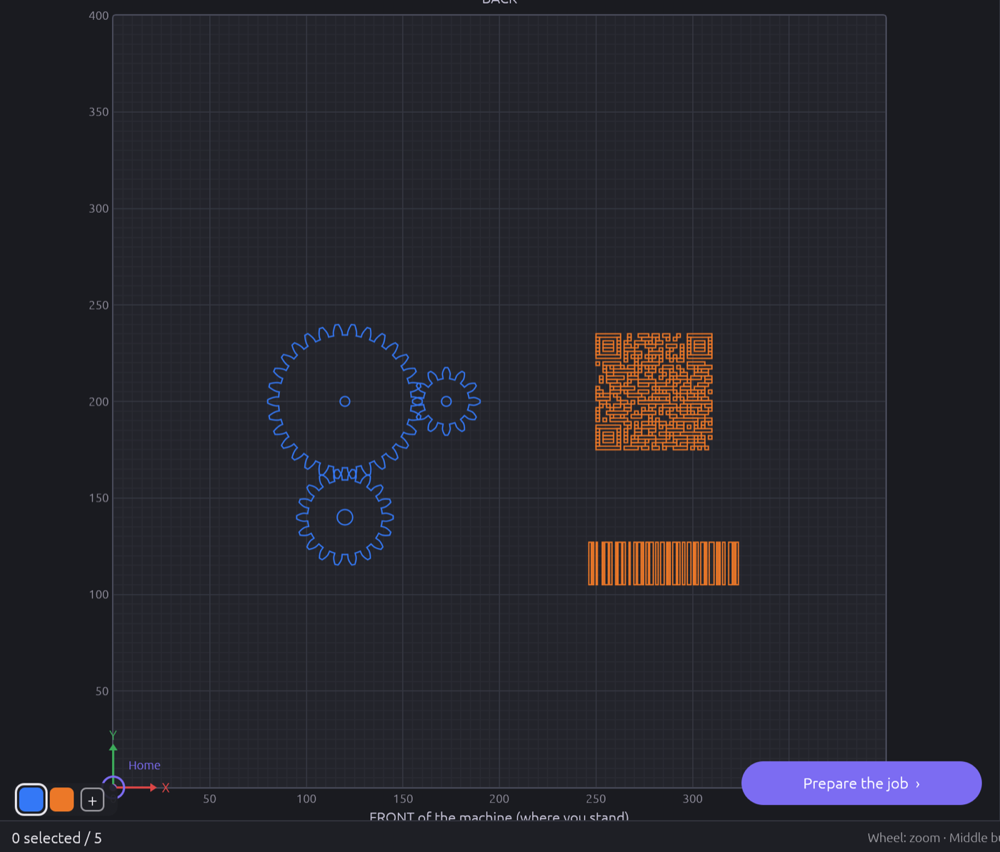<br><b>Gears</b> that really mesh (module, pressure angle, backlash), <b>QR codes</b> and <b>Code 128 barcodes</b> ready to engrave, layer colours in one click under the canvas.</td>
</tr>
<tr>
<td colspan="2">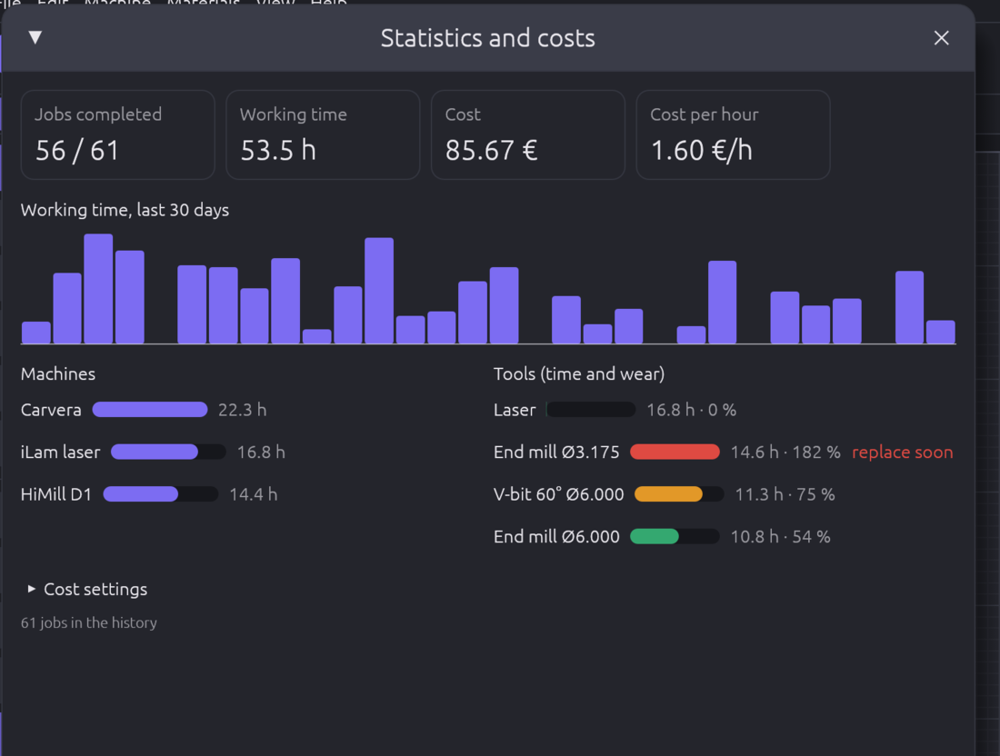<br><b>Statistics and costs</b>: jobs, working time, hours per machine and per tool with wear warnings, and the real cost of each job (machine wear, cutters, electricity, consumables, labour).</td>
</tr>
<tr>
<td colspan="2">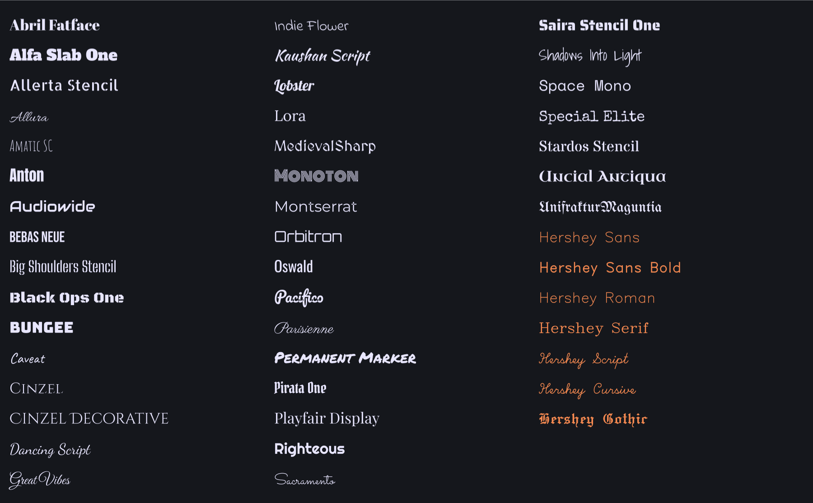<br><b>46 fonts built in</b>, the same on every computer: 39 open fonts and 7 single-line fonts (orange) for pens, V-bits and fast laser marking.</td>
</tr>
</table>

## Features

<details open>
<summary><b>🎨 Design</b></summary>

- Import **SVG** (CSS styles, text, transforms), **DXF** (arcs, bulges,
  splines, units), **PNG / JPG / BMP**, **STL / OBJ**; drag and drop; one
  layer per colour of a drawing.
- Draw rectangles, ellipses, polygons, **freehand strokes** (mouse, stylus,
  graphics tablet), **text** with 39 bundled open fonts (serif, scripts, medieval,
  stencils, slab, display, monospace), 7 single-line fonts and your own.
- **WordArt-like shapes**: text on an arc above or below a circle, waves,
  bulges, with live preview; the same deformations on any vector.
- **Combine** shapes: union, difference, intersection, exclusion.
- **Nesting**: parts and their copies packed on a sheet by their real
  outline (small parts go into the windows of big ones), quarter turns
  allowed, holes and engravings kept with their part.
- Move, scale, rotate with large handles (side handles stretch one axis,
  corners follow *Keep ratio*), snap, align, duplicate, grid or **circular
  arrays**, **contour offset** in or out, undo / redo, trace a picture to
  vectors.
- **Start panel** on an empty design, a **bar of layer colours** to sort
  shapes in one click, a **next step** button, and a **command palette**
  (`Ctrl/⌘ K`) that finds any action in any language, accents ignored.
- **Shape library**: your own SVG / DXF by theme and, when MaxmakeLAB is
  installed on the computer, its ~980 drawings read in place (never copied).
- **Tablet or phone** as a drawing pad (QR code, local network): a page
  that stays still under the stylus, palm rejection, line / marker /
  pressure brush, three intensities on their own layers, an eraser that
  also answers the stylus button, selection to move and resize; every
  change follows live on the computer.
- **Live link**: an imported file reloads in place when your drawing program
  saves it (Inkscape, Krita, Affinity, Procreate via a synced folder).
- **Insert SVG code** typed or pasted (or the `<svg>` of an HTML snippet).
- **Generators**: finger-jointed **box** sized for an object, **round box** with a living-hinge wall, **maze** (walls
  or corridors to mill), **jigsaw puzzle** (rectangle or **inside any
  shape**), children's **puzzle on lines** (pieces follow the heavy lines
  of a drawing or picture, with a tray), involute **gears**, **QR codes**
  and **Code 128** barcodes, a laser **test grid** (power × speed), random
  **ornaments** by style
  (Viking, Celtic, African, Maya, Greek, Japanese, Art Deco, Polynesian,
  Islamic).
- **Sprue**: parts packed in a frame with **bridges** placed automatically
  on calm stretches of each outline (model kits, 3D puzzle boards).
</details>

<details>
<summary><b>🔥 Laser</b></summary>

- Line (cut / engrave) with passes, Z step, **dashed / dotted** styles,
  holding **bridges** and **kerf compensation** so parts keep their size.
- **Fill** by lines at any angle (diagonal in one click), **circles** or
  **contours**; crosshatch, overscan, bidirectional; holes kept.
- **Image engraving**: greyscale, threshold, Bayer, Floyd–Steinberg,
  Atkinson, Jarvis, Stucki, **halftone (vintage)** and **line engraving**,
  swept by lines, **diagonals** or **circles**.
- M4 dynamic power, air assist, holes cut before outlines, minimal travel.
- **Laser offset** on laser + spindle machines (HiMill): laser layers are
  moved so engraving and milling of the same drawing line up.
- **Scan offset**: a speed → offset table, measured once on a built-in test
  pattern, keeps fast back-and-forth fills and pictures sharp.
- **Laser on paper**: pick the sheet (80 gsm, card stock, greyboard,
  corrugated) and the laser (diode or CO2, optical watts); each layer gets
  cut, perforate, mark or engrave settings from the energy the sheet needs.
- **Simplified 4-axis**: chuck on an A axis or rotary in place of Y with a
  single calibration value.
</details>

<details>
<summary><b>🛠️ CNC</b></summary>

- Outside / inside / on-line **profiles** with climb or conventional milling
  and holding **tabs**; **pockets** from the centre out; even pass depths.
- **V-bit engraving**: true V-carving of text and drawings (depth follows the
  stroke width) and pictures engraved deeper where darker.
- **3D model → G-code**: drop an STL or OBJ, choose the face, size, depth and
  tool, get roughing and finishing passes computed by drop-cutter (no gouge).
- **4-axis**: wrap a relief around a cylinder, or machine the whole part
  on round stock: roughing from 2 to 8 faces, then a **continuous finish**
  where the stock turns while cutting (simultaneous 4-axis, inverse time
  feed), with a holding stem so the part never comes loose.
- **Automatic tool changer** (Makera Carvera): each CNC layer picks its
  slot, the machine changes and measures the tool by itself.
- **Mold mode**: the imprint of a model sunk into the stock, with an even
  offset and automatic removal of small islands.
- **Orientation guide**: the best side up of a model for a 3-axis machine.
- **Stacked slices** of a model for plywood sculptures and 3D puzzles.
- **5-axis (3+2)** on a table-table machine: each side turned to the tool,
  the table avoided.
- **Tool library**: quick or advanced tool creation, **Fusion 360 import**,
  tool picker filling feeds, speeds and stepover.
</details>

<details>
<summary><b>📐 Probing, with or without a probe</b></summary>

- **No probe?** Jog until the tool, or a flexible rod, touches and click
  *Record*: top, tilted top, cube, block, standing or lying cylinder,
  trapezoid, each with the fewest touches; tool radius and paper shim
  compensated, squareness checked, G54 written. The tool length for the
  collision checks can be recorded by hand too.
- Work origin on a touch plate (Z) or an XYZ block (corner).
- **Find a centre**: inside a hole or pocket, or around a boss or block,
  X then Y, the work origin set in the middle (by hand too, for holes and
  pockets).
- **Flat mode**: 3 to 9 points give the plane of a tilted top face.
- **Uneven mode**: grid of adjustable size, without alarms where nothing is
  touched, which also **detects the shape of the piece**.
- Jobs **follow the surface** (Z compensation) and the laser can raise its
  power on slopes; the measured surface exports to **STL** for Fusion.
</details>

<details>
<summary><b>🧠 Assistance</b></summary>

- **Settings assistant**: recognises a photo, line art, lettering, outlines or
  a line drawing and proposes the operation and settings from your material
  library, or cautious defaults.
- **Material library**: one-click presets, MaxmakeLAB / LightBurn `.clb`
  import.
- **Import from your software**: Autodesk Fusion tool libraries, LightBurn
  and MaxmakeLAB material libraries found in their usual folders (macOS,
  Windows), imported in one click and kept up to date at start.
- **G-code repair**: comments, repeated words, zero moves, colinear segments,
  missing feed, relative / inch detection — with a diagnosis before applying.
- **Shorter travel**: paths ordered by nearest neighbour, then untangled
  (2-opt, Or-opt) while holes stay before outlines.
- **Spare the cutter and the machine**: plunges turned into ramps, feed
  lowered in sharp corners, with gentle and balanced profiles.
- **Statistics and costs**: time per tool, wear, dashboard, cost per job;
  production shares the wear fairly between machines.
- Tutorial on first launch, tooltips everywhere; English, French, German,
  Italian and Spanish.
- **AI assistants**: an MCP server lets Claude, Codex, Gemini or any MCP
  client generate designs and G-code (never runs a machine), see
  [docs/MCP.md](docs/MCP.md).
</details>

<details>
<summary><b>🔌 Machines</b></summary>

- **Detection** on USB (GRBL, grblHAL, FluidNC, Smoothieware, Carvera,
  Marlin, speed found) and on the network (telnet, Carvera, mDNS).
- **Production with several machines**: a shared queue of jobs, each machine
  with its own safety monitor, one emergency stop for all.
- Makera Carvera: Wi-Fi discovery, tool changer, halt reasons.
- **Maxmake HiMill D1S** profile (280 × 200 × 80 mm, home at the rear left
  of the moving table, programs framed like MaxmakeLAB does); its `GCARVIN`
  welcome line is recognised.
- **The bed is the machine's**: on connection the travel the controller
  reports (`$130`-`$132`) sets the bed size and Z travel.
- **Jog** with five precision levels from the pad or the keyboard, held to
  move until released, never past the travel ends once homed; the spindle
  can turn while approaching the material, with capped speeds.
- **Follow a job from a phone**: progress, time left, position; the page can
  only pause or stop, never start or resume.
- The bed shows the front, the back, the home corner and the axes.
- **Automatic updates** from GitHub releases, checked against their SHA-256.
</details>

## Safety first

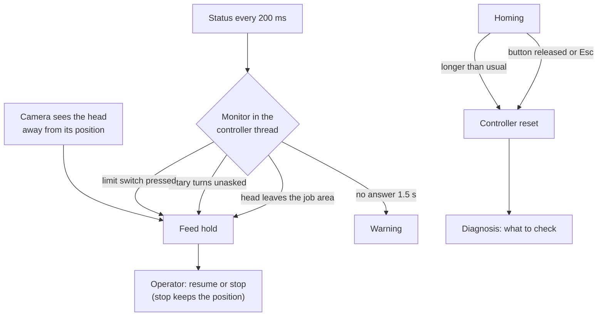

- **Before starting**: the whole job is checked against the machine travel
  using the live position; an open door blocks Start; laser jobs need an
  approved low-power **frame**, CNC jobs a **probed origin**; a short safety
  **checklist** (lid, glasses, clamping, fire watch).
- **Resume an interrupted job** from the move the head was really on (not
  the last line the controller had planned): the CNC goes up, across,
  restarts the spindle and plunges back slowly; the laser goes there off.
- **During the job**: automatic pause on anomalies (including the camera
  movement check, which catches lost steps and slipping belts), readable alarms with the
  action to take, Stop that keeps the position, emergency stop always visible.
- **Homing**: it only runs while its button is held (release or `Esc`
  resets the controller at once) or after a double click, it is cut when it
  lasts longer than usual, and a fast search speed can be lowered in one
  click. A failed homing says what to check (homing off with `$22=0`,
  switch not found, pull-off). Steppers feel no resistance: the pushing
  force itself is the motor current, set on the drivers.
- **Jogging** stays within the travel once homed (machine space computed
  from the home position, `$23` and `$130`-`$132`), and releasing a key or
  a button always stops the head.
- **Advanced mode** shows the console, macros and controller settings (`$$`
  with explanations). Only there can the mandatory checks be lifted; the
  live monitor stays on.

> The software emergency stop never replaces the physical one. GRBL drives
> open-loop motors: what is monitored is what the controller commands and
> every switch it reads.

## Install

Download the archive of your system from the
[latest release](https://github.com/barracudapps/MyMaxmakeLab/releases/latest)
(macOS universal `.app`, Linux, Windows). Installed copies update
themselves: every production release is downloaded, checked against its
SHA-256 and installed, and runs at next start (Help menu: check now, or
turn it off). What changed in each version: [CHANGELOG.md](CHANGELOG.md).

Publishing a release is pushing a version tag; CI tests, builds the three
platforms and attaches the archives:

```bash
git tag v0.2.0 && git push origin v0.2.0
```

From source:

```bash
git clone https://github.com/barracudapps/MyMaxmakeLab.git
cd MyMaxmakeLab
cargo run --release -p mml_app
```

Requirements: a recent stable Rust toolchain. Linux also needs
`libudev-dev` and the usual X11 / Wayland development packages.

```bash
cargo test --workspace      # 209 tests
cargo clippy --workspace    # no warnings
```

## Keyboard and command line

| Keys | Action | Keys | Action |
|---|---|---|---|
| `Ctrl/⌘ 1 2 3` | Design / Prepare / Run | `V R E P T D` | select, rectangle, ellipse, polygon, text, freehand |
| `Ctrl/⌘ Z`, `⇧Z` | undo / redo | `F` | fit to view |
| `Ctrl/⌘ D` | duplicate | arrows | nudge 1 mm (`⇧` 10 mm); in Run, jog X / Y |
| `Ctrl/⌘ I` / `O` / `S` | import / open / save | wheel, pinch | zoom; middle button or Space: pan |
| `Ctrl/⌘ K` | command palette | `Esc` | stops a homing in progress |
| `Page ↑` / `Page ↓` | jog Z (Run) | `1`…`5`, `+` / `−` | jog precision, Micro to Rapid (Run) |
| `⇧` / `⌥` held | one precision level coarser / finer | double click *Homing* | homing to the end by itself |

```bash
mymaxmakelab [--mode design|prepare|run] [--3d] [--play] [--open WINDOW]
             [--connect HOST:PORT] [--pair] [files…]
MYMAXMAKELAB_CONFIG_DIR=/path/on/usb mymaxmakelab   # portable settings
```

## Architecture

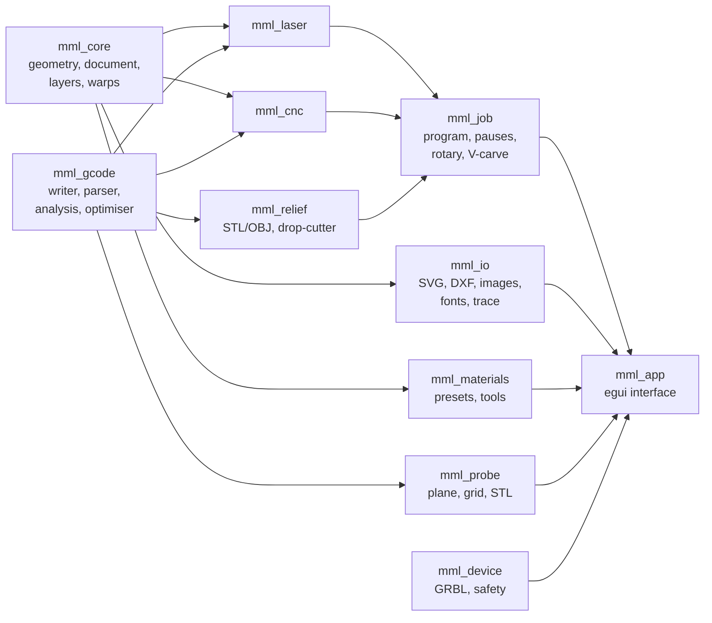

Every crate is pure and tested without the interface. The history follows the
Odoo commit convention (`[ADD]`, `[IMP]`, `[FIX]`… with the *why* in the
body): `git log` is the technical changelog. See
[CONTRIBUTING.md](CONTRIBUTING.md).

## Roadmap

- [x] Laser line / fill / image, CNC profile / pocket / V-carve / relief
- [x] Live safety monitor, probe, surface following, rotary
- [x] Assistant, tool library with Fusion import, G-code repair
- [x] Pairing with a tablet or phone drawing on a shared canvas (local web page, QR code)
- [x] Camera overlay: photo or live snapshots (phone, IP camera, GoPro, Insta360 pictures), 4-corner calibration
- [x] Movement consistency check by camera: laser dot or sticker followed, auto-pause on mismatch
- [x] GRBL-like firmwares (Smoothieware, Makera Carvera): send-and-wait streaming, legacy status reports
- [x] Makera Carvera: Wi-Fi discovery, automatic tool changer (M6 per layer), halt reasons (to validate on the machine)
- [x] Firmware update of open controllers (GRBL on Arduino via avrdude, grblHAL / FluidNC on ESP32 via esptool)
- [ ] Vendor firmware update (HiMill): needs the vendor protocol
- [x] Single-line (Hershey) fonts for pen and V-bit
- [x] 4-axis reliefs wrapped on the A axis
- [x] Indexed 4-axis machining (3+1): a whole part from 2 to 8 faces on round stock
- [x] Simultaneous 4-axis finish (helix, G93 inverse time), 3D preview around the A axis
- [x] Positional 5-axis (3+2) on a table-table machine
- [x] Mold mode, orientation guide, stacked slices
- [x] Generators: box, maze, jigsaw, ornaments by style; sprue with automatic bridges
- [x] Machine detection (USB, network), production with several machines
- [x] MCP server for AI assistants
- [x] macOS / Linux / Windows releases with automatic updates
- [x] Hand measurement without a probe, supervised homing
- [x] Stylus drawing page with brushes, eraser and live sync
- [x] Start panel, layer bar, shape library, gears, QR / barcodes, circular arrays, offsets
- [x] Scan offset for fast bidirectional fills, probe cycles that find the centre of a hole or a block
- [x] Resume an interrupted job, kerf compensation, combined shapes
- [x] Import from Fusion, LightBurn and MaxmakeLAB libraries; nesting on a sheet; puzzle inside any shape
- [x] Sample projects with step-by-step guides: CNC, laser and CNC + laser tests, puzzles and games (3D dragon, triceratops and galleon, slotted globe), decorations, optical illusions, a sundial, esoteric objects (sacred geometry, runes, talking board), a pendulum clock
- [x] Keyboard jog with precision levels, spindle next to the jog pad, homing diagnosis, durations learned from past jobs
- [x] Maxmake HiMill D1S profile, bed taken from the controller travel
- [ ] File transfer to the machine memory (HiMill SD card)
- [ ] Simultaneous 5-axis with tool orientation: needs the kinematics of a 5-axis machine

## 🇫🇷 En bref

MyMaxmakeLab remplace MaxmakeLAB par un atelier laser et CNC en Rust, rapide,
multiplateforme et pensé pour la sécurité : trois étapes (**Conception →
Préparation → Machine**), aperçu fidèle du programme réellement envoyé,
surveillance de la machine avec pause automatique, vérification des limites
sur la position réelle, cadrage à blanc et palpage obligatoires, assistant de
réglages, bibliothèque d'outils compatible Fusion 360, relief 3D depuis un STL,
gravure en V, styles de gravure laser, polices intégrées, texte en arc, 4e axe
(relief enroulé, pièce complète ébauchée sur plusieurs faces puis finie en continu), contrôle des
mouvements par caméra, Makera Carvera (découverte Wi-Fi, changeur d'outils),
réparation de G-code, moule, faces 5 axes, générateurs (boîte, labyrinthe,
puzzle, motifs par style), projets exemples guidés pas à pas (tests CNC,
laser et CNC + laser, casse-têtes et jeux dont des puzzles 3D, déco, illusions d'optique,
cadran solaire, objets ésotériques, horloge à balancier), grappes à ponts automatiques, détection des
machines, production sur plusieurs machines, serveur MCP pour les
assistants IA et mises à jour automatiques. Sans palpeur, l'origine se
relève à la main (bloc, cylindre, trapèze) ; le homing ne tourne que bouton
maintenu. Panneau de démarrage, barre des calques, bibliothèque de formes,
engrenages, QR codes, réseaux circulaires, décalage de contour, laser sur
papier et dessin au stylet sur tablette (gomme, pinceau à pression, suivi en
direct). Reprise d'un travail interrompu, imbrication des pièces sur la
plaque, puzzle dans n'importe quelle forme, import des bibliothèques Fusion,
LightBurn et MaxmakeLAB, déplacement au clavier avec niveaux de précision,
broche à côté du pavé, diagnostic du homing, profil Maxmake HiMill D1S et
plateau à la taille de la machine connectée. Interface en français, anglais, allemand, italien et espagnol, thèmes
clair et sombre. **[Manuel complet en français](docs/manuel/README.md)**.

---

<div align="center">
MyMaxmakeLab is released under the <a href="LICENSE">MIT license</a>.<br>
Fonts are redistributed under their own licenses, see
<a href="crates/mml_io/fonts/LICENSES.md">LICENSES.md</a>.
</div>
