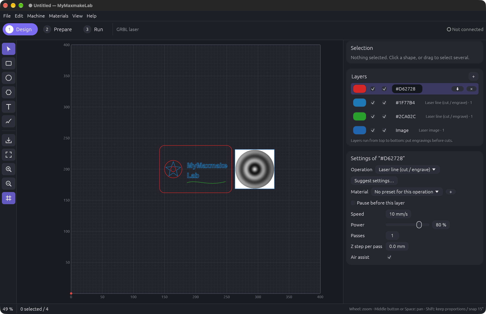
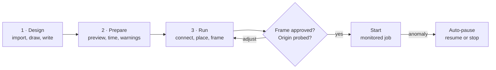
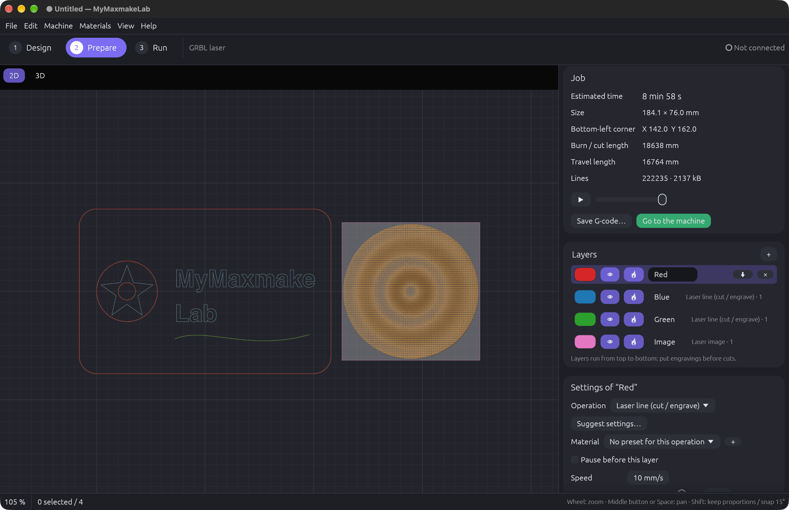
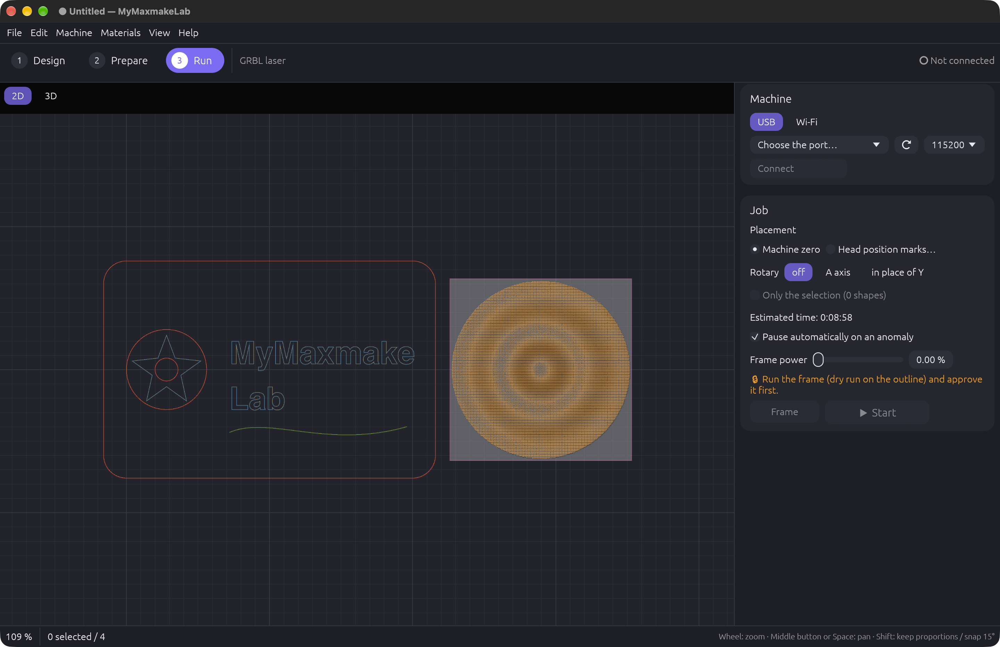
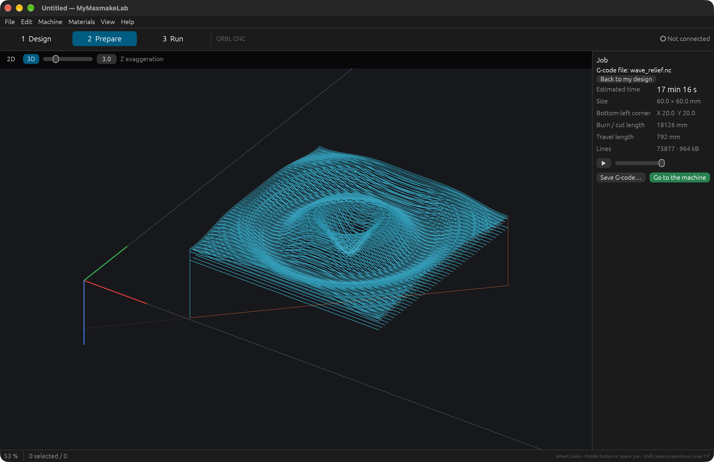
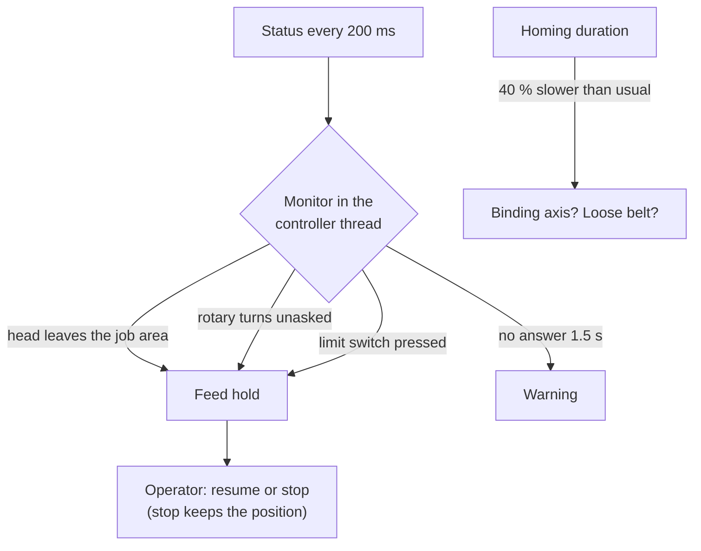
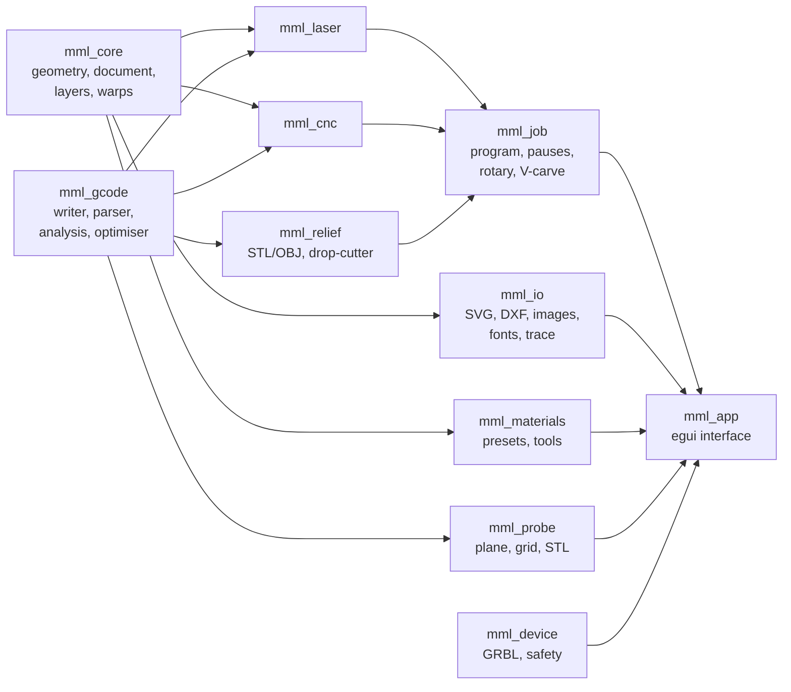

<div align="center">

# MyMaxmakeLab

**A friendly, fast and safe laser & CNC workbench for GRBL machines**

Design · Prepare · Run — from a sketch, a photo, a font or a 3D model to a finished piece.




[Why](#why) · [Tour](#a-quick-tour) · [Features](#features) · [Safety](#safety-first) ·
[Install](#install) · [Shortcuts](#keyboard-and-command-line) · [Architecture](#architecture) ·
[Roadmap](#roadmap) · [Français](#-en-bref)

</div>

---

## Why

MyMaxmakeLab started as a rewrite of MaxmakeLAB, the vendor software of the
Marxmake HiMill and iLam machines: powerful, but heavy (320 MB of Qt), slow
to start and hard to use. It keeps every useful feature, removes friction,
and adds what operators kept asking for: safety, reproducibility and help.

| | MaxmakeLAB | MyMaxmakeLab |
|---|---|---|
| Size / start | 320 MB, Qt + OpenCV + FFmpeg | one native binary, starts instantly |
| Workflow | many modes and dialogs | 3 steps: **Design → Prepare → Run** |
| Preview | separate from the program | the exact program streamed, parsed back |
| Safety | alarm and error codes | live monitor, auto-pause, limits checked on the real position, mandatory checks |
| Reproducibility | manual | probe-before-machining, approved dry-run frame |
| G-code | relative, every word repeated | absolute, modal, up to 7× lighter |
| Help | tour dialog | settings assistant, tooltips, skippable tutorial |
| Languages / themes | EN / ZH, one theme | EN / FR, light and dark |

## A quick tour



<table>
<tr>
<td width="50%"><b>Prepare</b>: the rendered burn, duration, size and warnings, updated as you tune the layers.<br></td>
<td width="50%"><b>Simulate</b>: watch the job being engraved before wasting material.<br></td>
</tr>
<tr>
<td><b>Run</b>: placement, rotary, checks and a Start button that is only green when it is safe.<br></td>
<td><b>3D</b>: orbit view of reliefs, multi-pass jobs and probed surfaces.<br></td>
</tr>
<tr>
<td><b>Repair and lighten</b> any G-code file, same path, fewer lines.<br></td>
<td><b>Light theme</b>: warm, rounded, readable.<br></td>
</tr>
</table>

## Features

<details open>
<summary><b>🎨 Design</b></summary>

- Import **SVG** (CSS styles, text, transforms), **DXF** (arcs, bulges,
  splines, units), **PNG / JPG / BMP**, **STL / OBJ**; drag and drop; one
  layer per colour of a drawing.
- Draw rectangles, ellipses, polygons, **freehand strokes** (mouse, stylus,
  graphics tablet), **text** with 20 bundled open fonts (scripts, stencils,
  slab, display) plus your own fonts.
- **WordArt-like shapes**: text on an arc above or below a circle, waves,
  bulges, with live preview; the same deformations on any vector.
- Move, scale, rotate with large handles, snap, align, duplicate, arrays,
  undo / redo, trace a picture to vectors.
- **Live link**: an imported file reloads in place when your drawing program
  saves it (Inkscape, Krita, Affinity, Procreate via a synced folder).
- **Insert SVG code** typed or pasted (or the `<svg>` of an HTML snippet).
</details>

<details>
<summary><b>🔥 Laser</b></summary>

- Line (cut / engrave) with passes, Z step and **dashed / dotted** styles.
- Scanline **fill** with angle, crosshatch, overscan, bidirectional; shapes
  united, holes kept.
- **Image engraving**: greyscale, threshold, Bayer, Floyd–Steinberg,
  Atkinson, Jarvis, Stucki, **halftone (vintage)** and **line engraving**.
- M4 dynamic power, air assist, holes cut before outlines, minimal travel.
- **Simplified 4-axis**: chuck on an A axis or rotary in place of Y with a
  single calibration value.
</details>

<details>
<summary><b>🛠️ CNC</b></summary>

- Outside / inside / on-line **profiles** with climb or conventional milling
  and holding **tabs**; **pockets** from the centre out; even pass depths.
- **V-bit engraving**: true V-carving of text and drawings (depth follows the
  stroke width) and pictures engraved deeper where darker.
- **3D model → G-code**: drop an STL or OBJ, choose the face, size, depth and
  tool, get roughing and finishing passes computed by drop-cutter (no gouge).
- **Tool library**: quick or advanced tool creation, **Fusion 360 import**,
  tool picker filling feeds, speeds and stepover.
</details>

<details>
<summary><b>📐 3D probe</b></summary>

- Work origin on a touch plate (Z) or an XYZ block (corner).
- **Flat mode**: 3 to 9 points give the plane of a tilted top face.
- **Uneven mode**: grid of adjustable size, without alarms where nothing is
  touched, which also **detects the shape of the piece**.
- Jobs **follow the surface** (Z compensation) and the laser can raise its
  power on slopes; the measured surface exports to **STL** for Fusion.
</details>

<details>
<summary><b>🧠 Assistance</b></summary>

- **Settings assistant**: recognises a photo, line art, lettering, outlines or
  a line drawing and proposes the operation and settings from your material
  library, or cautious defaults.
- **Material library**: one-click presets, MaxmakeLAB / LightBurn `.clb`
  import (offered on first launch).
- **G-code repair**: comments, repeated words, zero moves, colinear segments,
  missing feed, relative / inch detection — with a diagnosis before applying.
- Tutorial on first launch, tooltips everywhere, English and French.
</details>

## Safety first



- **Before starting**: the whole job is checked against the machine travel
  using the live position; an open door blocks Start; laser jobs need an
  approved low-power **frame**, CNC jobs a **probed origin**; a short safety
  **checklist** (lid, glasses, clamping, fire watch).
- **During the job**: automatic pause on anomalies, readable alarms with the
  action to take, Stop that keeps the position, emergency stop always visible.
- **Advanced mode** shows the console, macros and controller settings (`$$`
  with explanations). Only there can the mandatory checks be lifted; the
  live monitor stays on.

> The software emergency stop never replaces the physical one. GRBL drives
> open-loop motors: what is monitored is what the controller commands and
> every switch it reads.

## Install

```bash
git clone https://github.com/barracudapps/MyMaxmakeLab.git
cd MyMaxmakeLab
cargo run --release -p mml_app
```

Requirements: a recent stable Rust toolchain. Linux also needs
`libudev-dev` and the usual X11 / Wayland development packages.

```bash
cargo test --workspace      # 74 tests
cargo clippy --workspace    # no warnings
```

## Keyboard and command line

| Keys | Action | Keys | Action |
|---|---|---|---|
| `Ctrl/⌘ 1 2 3` | Design / Prepare / Run | `V R E P T D` | select, rectangle, ellipse, polygon, text, freehand |
| `Ctrl/⌘ Z`, `⇧Z` | undo / redo | `F` | fit to view |
| `Ctrl/⌘ D` | duplicate | arrows | nudge 1 mm (`⇧` 10 mm) or jog in Run |
| `Ctrl/⌘ I` / `O` / `S` | import / open / save | wheel, pinch | zoom; middle button or Space: pan |

```bash
mymaxmakelab [--mode design|prepare|run] [--3d] [--play] [files…]
MYMAXMAKELAB_CONFIG_DIR=/path/on/usb mymaxmakelab   # portable settings
```

## Architecture



Every crate is pure and tested without the interface. The history follows the
Odoo commit convention (`[ADD]`, `[IMP]`, `[FIX]`… with the *why* in the
body): `git log` is the technical changelog. See
[CONTRIBUTING.md](CONTRIBUTING.md).

## Roadmap

- [x] Laser line / fill / image, CNC profile / pocket / V-carve / relief
- [x] Live safety monitor, probe, surface following, rotary
- [x] Assistant, tool library with Fusion import, G-code repair
- [x] Pairing with a tablet or phone drawing on a shared canvas (local web page, QR code)
- [ ] Camera overlay and movement consistency check (webcam, phone, Insta360, GoPro)
- [ ] Native protocols for non-GRBL machines (Makera Carvera, Smoothieware)
- [ ] Firmware update per vendor protocol
- [ ] Single-line (Hershey) fonts for pen and V-bit
- [ ] 4-axis reliefs and 5-axis machining with a kinematics model

## 🇫🇷 En bref

MyMaxmakeLab remplace MaxmakeLAB par un atelier laser et CNC en Rust, rapide,
multiplateforme et pensé pour la sécurité : trois étapes (**Conception →
Préparation → Machine**), aperçu fidèle du programme réellement envoyé,
surveillance de la machine avec pause automatique, vérification des limites
sur la position réelle, cadrage à blanc et palpage obligatoires, assistant de
réglages, bibliothèque d'outils compatible Fusion 360, relief 3D depuis un STL,
gravure en V, styles de gravure laser, polices intégrées, texte en arc, 4e axe,
réparation de G-code. Interface en français et en anglais, thèmes clair et
sombre.

---

<div align="center">
Fonts are redistributed under their own licenses, see
<a href="crates/mml_io/fonts/LICENSES.md">LICENSES.md</a>.
</div>
