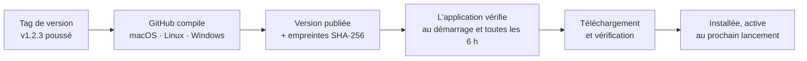

[Sommaire](README.md) · [Interface →](02-interface.md)

# 1. Prise en main

MyMaxmakeLab prépare et pilote des travaux de **gravure laser** et de
**fraisage CNC** sur les machines GRBL (Marxmake HiMill et iLam, machines
GRBL / grblHAL / FluidNC, Makera Carvera…). Ce chapitre vous amène de
l'installation à votre première pièce.

## Installer

| Système | Comment |
|---|---|
| macOS | Téléchargez `MyMaxmakeLab-macos-universal.zip` depuis la [dernière version](https://github.com/barracudapps/MyMaxmakeLab/releases/latest), décompressez, glissez **MyMaxmakeLab.app** dans *Applications*. |
| Windows | Téléchargez `MyMaxmakeLab-windows-x86_64.zip`, décompressez où vous voulez, lancez `mymaxmakelab.exe`. |
| Linux | Téléchargez `MyMaxmakeLab-linux-x86_64.tar.gz`, décompressez dans `~/.local/bin`, lancez `mymaxmakelab`. |
| Depuis les sources | `git clone https://github.com/barracudapps/MyMaxmakeLab.git && cd MyMaxmakeLab && cargo run --release -p mml_app` |

L'application tient en un seul fichier d'environ 20 Mo, sans installation
de dépendances.

## Mises à jour automatiques

- Seules les **versions de production** (`v1.2.3`, sans suffixe) sont
  installées ; les versions de test sont ignorées.
- Le menu **Aide** permet de *Rechercher les mises à jour* tout de suite,
  de couper l'installation automatique et affiche la version.
- Une copie lancée depuis un dossier de compilation ne se remplace jamais.

## Premier lancement

1. **Tutoriel** : quelques bulles présentent les trois étapes ; vous pouvez
   le passer et le relancer depuis l'aide.
2. **Importer depuis vos logiciels** : l'application cherche les
   bibliothèques là où vos logiciels les rangent (outils d'Autodesk Fusion,
   matériaux LightBurn `.clb`, bibliothèque de MaxmakeLAB) et propose de les
   importer d'un clic. Avec *Garder à jour automatiquement*, une bibliothèque
   modifiée depuis est relue au démarrage : seuls les nouveaux outils et
   réglages sont ajoutés, rien n'est effacé. Fenêtre accessible ensuite par
   **Matériaux › Importer depuis vos logiciels…**.
3. **Machine** : choisissez votre profil dans le menu **Machine** (laser,
   CNC, CNC + laser, Makera Carvera) puis ajustez-le dans *Réglages de la
   machine* (taille du plateau, origine, puissance maximale `$30`…).

## Démarrer avec une Maxmake HiMill D1S

1. Branchez la machine en USB, puis **Machine › Connecter** (ou
   *Détecter les machines*). La HiMill se présente sous le nom GCARVIN :
   l'application propose **Utiliser le profil HiMill D1S** ; acceptez (ou
   choisissez-le dans le menu **Machine**). Le plateau prend la course de la
   machine (280 × 200 mm) et le repère home passe en haut à gauche : broche
   à gauche, plateau mobile avancé vers vous.
2. **Homing** : gardez le bouton enfoncé en surveillant la machine, ou
   double-cliquez pour qu'il aille au bout tout seul. En cas d'échec, un
   encadré dit quoi vérifier.
3. **Déplacer la tête** avec le pavé ou les flèches (Page ↑/↓ pour Z),
   d'abord en précision *Micro* ou *Fin* pour vérifier le sens de chaque
   axe. Y+ va vers l'arrière : la flèche du bas ramène l'outil vers vous.
4. Faites l'origine (*Zéro XY ici*, palpage ou relevé à la main), puis
   **Lancer le travail** : chaque programme est encadré par
   `[STREAM_START]` / `[STREAM_END]`, comme dans MaxmakeLAB.

## Langue, thème, réglages portables

- Langues : français, anglais, allemand, italien, espagnol (menu
  **Affichage**). La langue du système est choisie au premier lancement.
- Thèmes clair et sombre.
- Pour emporter vos réglages sur une clé USB :
  `MYMAXMAKELAB_CONFIG_DIR=/Volumes/CLE/mml mymaxmakelab`.

## Votre première pièce en 3 minutes

1. **Conception** : faites glisser un SVG, une image ou un texte sur la
   fenêtre ([Conception](03-conception.md)).
2. Choisissez l'opération de chaque calque : découpe, gravure, image…
3. **Préparation** : vérifiez le rendu, la durée et le coût estimés.
4. **Machine** : connectez-vous, placez la pièce, faites le **cadrage**
   (passage à blanc), puis **Démarrer** ([Sécurité](09-securite.md)).

---

[Sommaire](README.md) · [Interface →](02-interface.md)
