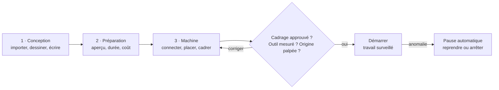
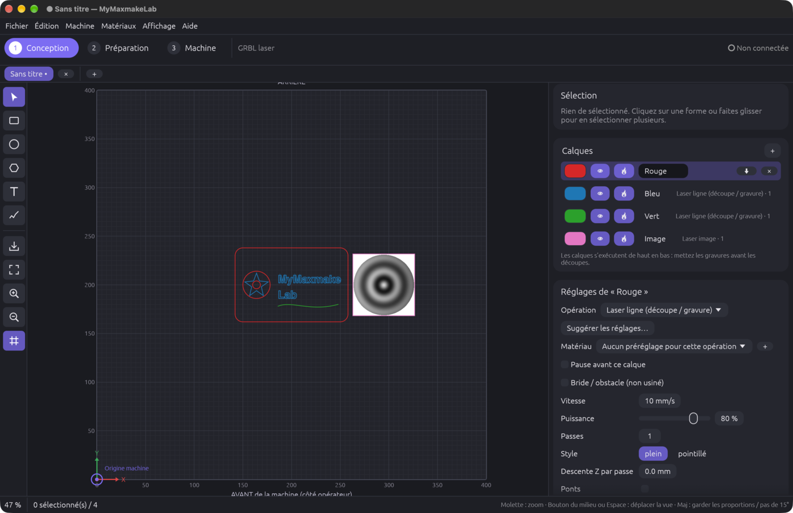
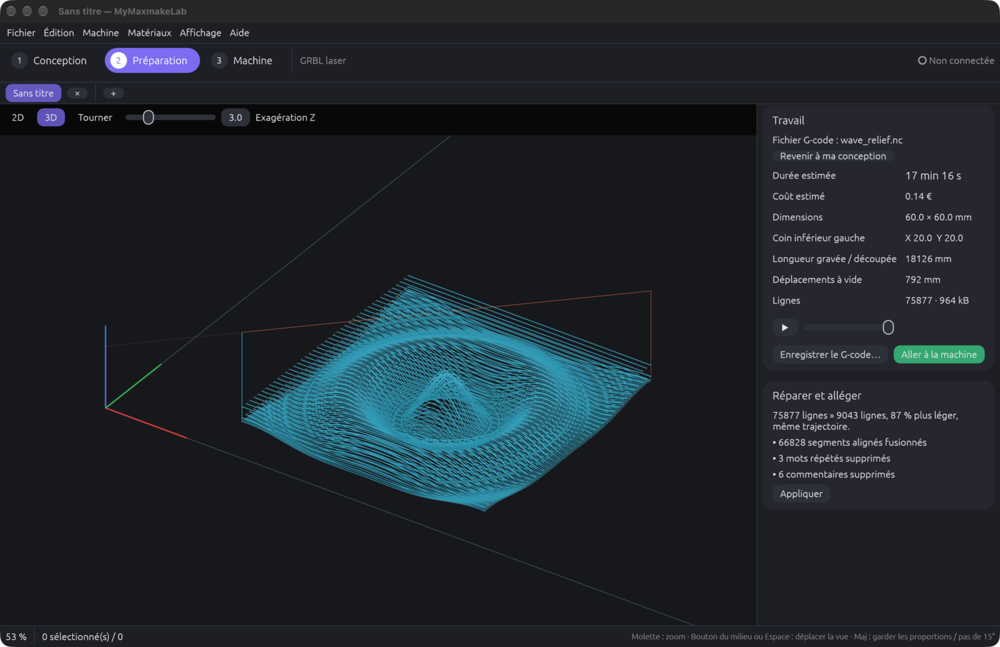

[← Prise en main](01-prise-en-main.md) · [Sommaire](README.md) · [Conception →](03-conception.md)

# 2. Interface

L'interface suit le travail réel : **Conception → Préparation → Machine**.

## Les zones de l'écran

| Zone | Rôle |
|---|---|
| Barre du haut | Menus, les trois étapes (`Ctrl/⌘ 1 2 3`), profil machine, état de connexion |
| Onglets | Plusieurs projets ouverts, chacun avec son historique (`⌘N` nouvel onglet) |
| Outils à gauche | Sélection, rectangle, ellipse, polygone, texte, dessin à main levée, import, zoom |
| Plateau au centre | Le plateau de la machine à l'échelle, vos formes, l'aperçu du programme |
| Panneau à droite | Sélection, calques, réglages de l'opération, puis travail et machine selon l'étape |
| Bas du plateau | Pastilles des calques à gauche ; à droite, le bouton de l'étape suivante (*Préparer le travail ›*, *Aller à la machine ›*) |

## Repères du plateau

Le plateau à l'écran correspond au plateau réel :

- **AVANT de la machine (côté opérateur)** est écrit sous le bord avant,
  **ARRIÈRE** au-dessus du bord arrière ;
- le coin d'**Origine machine** (où la machine fait son retour à zéro) est
  entouré, selon le profil de la machine ;
- les flèches **X** (rouge) et **Y** (vert) partent de l'origine du dessin.

## Naviguer

| Action | Geste |
|---|---|
| Zoomer | molette, pincement |
| Déplacer la vue | bouton du milieu, ou Espace + glisser |
| Tout voir | `F` |
| Déplacer une forme | glisser, ou flèches (1 mm, `⇧` 10 mm) |
| Garder les proportions / pas de 15° | `⇧` pendant la poignée |
| Dupliquer | `Ctrl/⌘ D` |
| Annuler / rétablir | `Ctrl/⌘ Z` / `⇧ Ctrl/⌘ Z` |

## Historique et projets

- Chaque action porte un nom (Importer, Aligner, Déformer…) : **Édition ›
  Historique** permet de revenir directement à n'importe laquelle des 15
  dernières.
- L'historique est enregistré dans le fichier `.mml` : `⌘Z` fonctionne
  encore après réouverture.
- Fermer un onglet ou l'application demande confirmation s'il reste des
  modifications.

## Vue 3D

En Préparation et Machine, **3D** montre le programme en volume ; **Tourner**
fait pivoter la vue lentement autour de la pièce. Les programmes 4 et 5
axes sont dessinés sur la pièce à l'échelle réelle.

---

[← Prise en main](01-prise-en-main.md) · [Sommaire](README.md) · [Conception →](03-conception.md)
