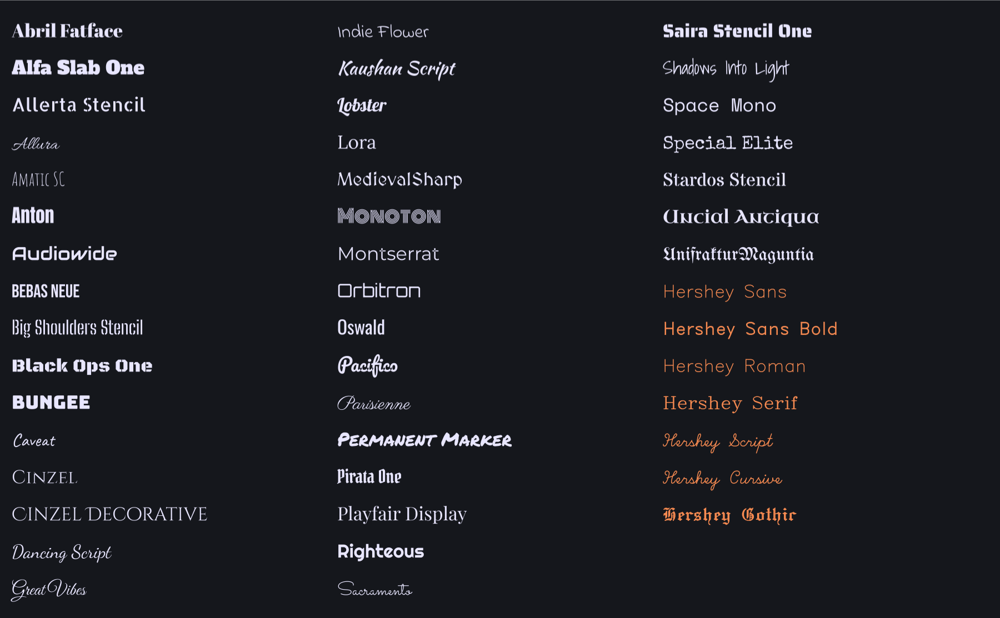

[← Interface](02-interface.md) · [Sommaire](README.md) · [Gravure et découpe laser →](04-laser.md)

# 3. Conception

## Importer

| Format | Ce qui est repris |
|---|---|
| **SVG** | tracés, styles CSS, textes, transformations ; un calque par couleur |
| **DXF** | lignes, arcs, renflements, splines, unités |
| **PNG / JPG / BMP** | image à graver ou à vectoriser (*Vectoriser l'image*) |
| **STL / OBJ** | modèle 3D, ouvre l'assistant [3D](06-3d-multi-axes.md) |
| **G-code** (`.nc`, `.gcode`) | programme existant, à prévisualiser, réparer et lancer |

Glissez-déposez les fichiers sur la fenêtre ou utilisez `Ctrl/⌘ I`.

Sur un dessin vide, le panneau **Que voulez-vous faire ?** propose tous les
points de départ : importer, bibliothèque de formes, texte, générateurs,
tablette, laser sur papier, ouvrir un projet, et les derniers fichiers.

**Bibliothèque de formes** : des dessins prêts à graver, classés par thème,
insérés d'un clic au centre du plateau. Elle montre vos propres SVG et DXF
(*Mon dossier…*, un sous-dossier par thème) et, si MaxmakeLAB est installé
sur l'ordinateur, ses quelque 980 dessins, lus sur place sans copie.

**Lien dynamique** : un fichier importé se recharge tout seul quand votre
logiciel de dessin l'enregistre (Inkscape, Affinity, Krita, Procreate via un
dossier synchronisé).

## Dessiner et écrire

- Rectangle, ellipse, polygone, **main levée** (souris, stylet, tablette).
- **Texte** avec 39 polices libres intégrées et 7 polices à trait unique
  (Hershey) pour le stylo, la fraise en V et le marquage rapide ; vos
  polices personnelles sont ajoutées depuis les préférences.

- **Déformations façon WordArt** : texte en arc au-dessus ou au-dessous d'un
  cercle, vague, bombé, avec aperçu ; elles s'appliquent aussi à tout
  dessin vectoriel.
- **Code SVG** : collez du SVG ou le `<svg>` d'une page HTML.
- **Tablette ou téléphone** : *Fichier › Appairer* affiche un QR code ; on
  dessine au doigt ou au stylet sur une page web, et chaque changement
  arrive en direct sur l'ordinateur.
  - La page reste **fixe** : elle ne défile ni ne zoome sous le stylet, et
    les doigts sont ignorés dès qu'un stylet a servi (paume posée).
  - **Brosses** : *trait* (ligne centrale, pour graver ou découper un
    trait), *marqueur* (largeur constante, rempli) et *pinceau* (largeur
    selon la pression du stylet, rempli).
  - **Intensité** légère, moyenne ou forte : chaque intensité va sur son
    calque, avec 35 %, 65 % ou 100 % de la puissance (ou de la profondeur
    en fraisage).
  - **Gomme** : outil Gomme, ou bouton du stylet maintenu (S Pen, etc.) ;
    elle efface seulement la partie touchée.
  - **Sélection** : toucher un trait ou tracer un cadre, puis déplacer,
    redimensionner (poignées des coins ou des côtés, proportions au choix),
    changer l'intensité ou la largeur, supprimer. Le mouvement est suivi en
    direct sur l'ordinateur.
  - Annuler et rétablir sur la page ; une forme modifiée sur l'ordinateur
    n'est plus touchée tant que le trait n'est pas changé sur la tablette.

## Organiser

Poignées de déplacement, redimensionnement et rotation, magnétisme sur la
grille, alignements, duplication, **répétitions** (grille de copies, ou
copies **en cercle** avec un nombre, un rayon et un angle, tournées ou non),
**décalage** de contour vers l'extérieur ou l'intérieur (coins arrondis ; un
trait ouvert reçoit le contour qui l'entoure), **grappes** (voir
[Générateurs](07-generateurs.md)).

Les poignées des coins suivent la case *Garder les proportions* (`Maj`
l'inverse) ; celles du milieu des côtés changent seulement la largeur ou la
hauteur.

**Barre des calques** : en bas à gauche du plateau, une pastille par calque.
Avec des formes sélectionnées, un clic les met sur ce calque ; sans
sélection, il en fait le calque courant ; **+** crée un calque (et y met la
sélection).

## Calques et opérations

Chaque calque porte **une opération** et s'exécute de haut en bas :
mettez les gravures avant les découpes.

| Opération | Pour |
|---|---|
| Laser ligne | découper, graver un trait, pointillés, ponts |
| Laser remplissage | remplir des zones (lignes, diagonale, cercles, contours) |
| Laser image | graver une photo (tramages, motifs) |
| CNC profil | détourer à l'extérieur, à l'intérieur ou sur la ligne |
| CNC poche | vider une zone |
| CNC gravure en V | graver du texte ou un dessin avec une fraise en V |

Options d'un calque : **Pause avant ce calque** (changer d'outil),
**Bride / obstacle (non usiné)** avec la hauteur de son sommet (voir
[Sécurité](09-securite.md)), emplacement du **changeur d'outils** sur les
machines équipées.

**Suggérer les réglages…** analyse le contenu du calque (photo, dessin au
trait, texte…) et propose l'opération et les réglages de votre bibliothèque
de matériaux.

---

[← Interface](02-interface.md) · [Sommaire](README.md) · [Gravure et découpe laser →](04-laser.md)
