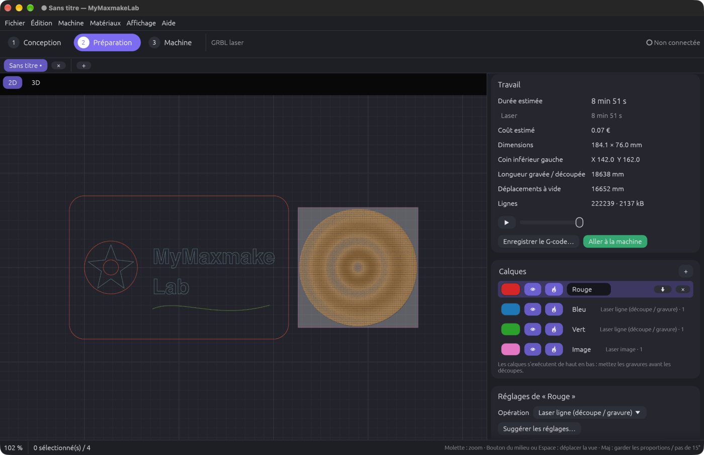

[← Conception](03-conception.md) · [Sommaire](README.md) · [Fraisage CNC →](05-fraisage.md)

# 4. Gravure et découpe laser

## Laser ligne

| Réglage | Effet |
|---|---|
| Vitesse, puissance, passes | la puissance est en % du maximum (`$30`) ; plusieurs passes pour les matériaux épais |
| Descente Z par passe | abaisse la tête entre les passes (contreplaqué épais) |
| Style plein / pointillé | pointillés pour les lignes de pliage et les perforations |
| **Ponts** | petits ponts non découpés qui retiennent la pièce dans la planche ; en automatique, ils vont sur les portions droites, loin des angles |
| Assistance d'air | `M8` pendant le calque |

Les trous sont découpés avant les contours, et l'ordre des tracés réduit
les déplacements à vide (voir [Production](11-production-statistiques.md)).

## Laser remplissage

- **Motif** : *lignes* à n'importe quel angle (boutons 0°, 45°, 90°, 135°
  pour la diagonale), *cercles* autour du centre, *contours* qui suivent la
  forme vers l'intérieur.
- Intervalle entre lignes, hachures croisées, aller-retour, **dépassement**
  (la tête atteint sa vitesse avant de brûler).

## Laser image

Niveaux de gris (puissance variable), seuil, Bayer, Floyd–Steinberg,
Atkinson, Jarvis, Stucki, **similigravure (vintage)**, **gravure au trait** ;
motif de balayage en lignes, **diagonale** ou **cercles** ; résolution
(dpi), luminosité, contraste, négatif.

## Décalage de balayage

En gravure aller-retour rapide, les lignes de retour arrivent un peu
décalées : les bords paraissent dentelés et les petits textes flous.
*Machine › Réglages de la machine › Décalage de balayage* :

1. **Motif de mesure** ajoute un carré par vitesse (1000 à 6000 mm/min),
   gravé en aller-retour, la vitesse gravée à côté ;
2. gravez-le, mesurez à la loupe la largeur des dents sur les bords de
   chaque carré ;
3. entrez une ligne *vitesse → décalage* par carré.

Les remplissages et les images en aller-retour sont alors corrigés : la
valeur est interpolée entre les vitesses mesurées.

## Laser sur papier (configuration rapide)

*Matériaux › Laser sur papier…* (ou `⌘K` « papier ») règle tous les calques
d'un coup :

1. choisissez la feuille : papier 80 g, bristol 200–300 g, carton gris
   1,5 mm ou carton ondulé 3 mm ;
2. indiquez le laser : diode ou CO2, sa **puissance optique** (celle du
   faisceau, pas la puissance électrique) et la vitesse maximale propre de
   la machine ;
3. chaque calque reçoit un rôle deviné d'après son contenu, modifiable :
   **découper**, **pointillés** (pliage, détachage), **marquer le trait**,
   **graver le remplissage**, ou ne pas modifier (les images sont laissées
   telles quelles).

Vitesse, puissance et nombre de passes découlent de l'énergie dont chaque
feuille a besoin par millimètre : trop rapide pour la machine, la puissance
est réduite plutôt que de brûler plus large ; trop lent, le travail passe en
plusieurs passes pour ne pas roussir les bords. L'assistance d'air reste
coupée pour le papier fin (il s'envolerait).

- Le papier blanc renvoie la lumière bleue d'une diode : un papier coloré ou
  un trait de feutre noir sous la ligne aide beaucoup.
- Fixez la feuille à plat et faites la mise au point sur son dessus.
- Ne laissez jamais la machine seule : le papier s'enflamme facilement.
- Ce sont des points de départ : **Grille de test…** ouvre la grille de test
  avec des puissances et vitesses autour de ces réglages.

## Gravure sur cylindre

Dans **Machine**, *Rotatif* : mandrin sur un vrai axe A, ou rouleaux à la
place de Y avec une seule valeur d'étalonnage. Le dessin est déroulé : sa
hauteur vaut π × diamètre.

## Cadrage (passage à blanc)

Avant tout travail laser, **Cadrer** fait le tour du dessin à très faible
puissance : vous vérifiez la position sur la pièce, puis vous
**approuvez**, corrigez ou relancez. Le démarrage reste bloqué tant que le
cadrage n'est pas approuvé.

---

[← Conception](03-conception.md) · [Sommaire](README.md) · [Fraisage CNC →](05-fraisage.md)
