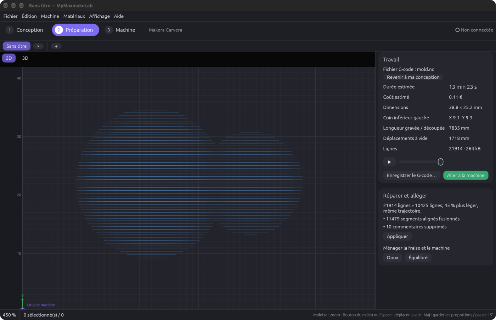
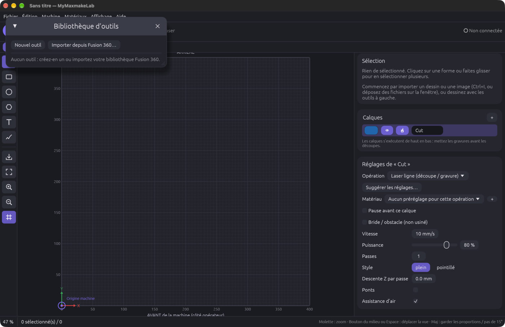
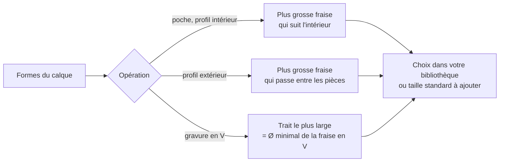
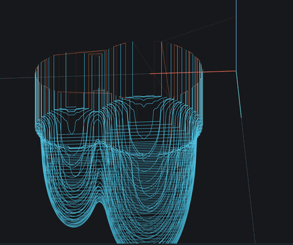

[← Gravure et découpe laser](04-laser.md) · [Sommaire](README.md) · [3D, 4 et 5 axes →](06-3d-multi-axes.md)

# 5. Fraisage CNC

## Opérations

- **Profil** extérieur, intérieur ou sur la ligne, en avalant ou en
  opposition, passes de profondeur égales, **attaches** de maintien placées
  automatiquement loin des angles.
- **Poche** du centre vers l'extérieur.
- **Gravure en V** : vraie gravure en V du texte et des dessins (la
  profondeur suit la largeur du trait), images gravées plus profond là où
  elles sont sombres.
- **Relief** à la fraise boule (ou plate) sur des formes du dessin : un
  contour extérieur délimite la zone creusée, les contours à l'intérieur
  ressortent en motifs aux bords arrondis (en quart de cercle, sur la
  largeur « Arrondi des bords »), ceux à l'intérieur d'un motif sont
  recreusés. Ébauche par niveaux avec la même fraise puis finition ; la
  fraise ne sort jamais du contour extérieur. Les images y deviennent un
  relief, plus profond là où elles sont sombres.

## Bibliothèque d'outils et suggestion

- Création simple ou avancée, **import depuis Fusion 360**.
- Le sélecteur d'outil d'un calque remplit avance, vitesse de broche,
  profondeur de passe et recouvrement.
- **Suggérer** mesure les formes du calque : la plus grosse fraise qui garde
  tous les détails (fente étroite, angle intérieur, espace entre deux
  pièces), ou la fraise en V assez large pour le trait le plus épais avec la
  profondeur atteinte. Si votre bibliothèque n'a rien qui convient, la
  taille standard à ajouter est indiquée ; pour des détails plus fins que
  toute fraise, le laser ou la gravure en V sont proposés.

## Ménager la fraise et la machine

Dans la carte **Réparer et alléger** de Préparation (fraisage uniquement) :

| Profil | Rampes | Angles vifs |
|---|---|---|
| **Doux** | plongées en zigzag à 3° | demi-avance sur 1,5 mm autour des angles de plus de 45° |
| **Équilibré** | rampes à 8° | trois quarts d'avance autour des angles de plus de 75° |

Le trajet ne change pas ; l'application indique le nombre de rampes et
d'angles traités, et le temps ajouté.

## Changeur d'outils (Makera Carvera)

Avec un profil à changeur d'outils, chaque calque choisit son emplacement
(1 à 6) : la machine change et mesure l'outil elle-même (`M6 T…`), sans
pause.

## Moule

Dans l'assistant de modèle 3D, **Moule** usine l'empreinte du modèle
enfoncé dans le brut : profondeur d'enfoncement, **décalage** uniforme
(jeu, retrait au moulage), **suppression des petits îlots**, miroir pour la
seconde moitié.

---

[← Gravure et découpe laser](04-laser.md) · [Sommaire](README.md) · [3D, 4 et 5 axes →](06-3d-multi-axes.md)
