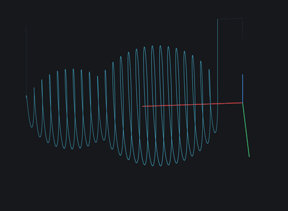
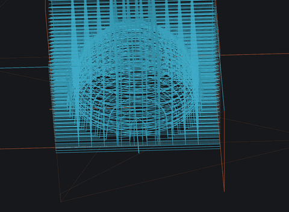

[← Fraisage CNC](05-fraisage.md) · [Sommaire](README.md) · [Générateurs →](07-generateurs.md)

# 6. 3D, 4 et 5 axes

Déposez un **STL** ou un **OBJ** : l'assistant de modèle 3D s'ouvre.

## Relief 3 axes

Choisissez la face, la taille, la profondeur, l'outil (boule ou plat), le
recouvrement et la profondeur de passe. L'ébauche par niveaux puis la
finition sont calculées par « drop-cutter » : l'outil est descendu jusqu'à
toucher la surface sous toute son empreinte, il n'entaille jamais le
modèle.

**Suggérer la meilleure face vers le haut** compare les six poses : part de
la surface accessible par le dessus, hauteur, assise à plat. Un clic tourne
le modèle.

## Tranches empilées (puzzle 3D)

**Créer les tranches** découpe le modèle en couches de l'épaisseur de la
planche. Chaque tranche est disposée à plat, numérotée par une gravure
légère, prête à découper puis empiler et coller.

## 4 axes

| Mode | Usage |
|---|---|
| **Enroulé (axe A)** | un relief enroulé autour d'un cylindre |
| **Faces 4 axes** | la pièce entière, ébauchée sur 2 à 8 faces |
| **Finition 4 axes continue** | le brut tourne pendant la coupe, l'outil suit une hélice (avance en temps inverse G93) |

Une **tige de maintien** le long de l'axe n'est jamais coupée : la pièce ne
se détache pas du mandrin. Réglages : Y0 sur l'axe A, Z0 sur le dessus du
brut ; vérifiez le sens positif de A par un petit déplacement.

## 5 axes positionnel (3+2)

Avec un plateau basculant A/C décrit dans les réglages de la machine
(hauteur du plateau au-dessus de l'axe A, rayon, course de A), **faces 5
axes** tourne chaque face choisie vers l'outil puis l'usine en 3 axes. Le
plateau est évité ; la broche, le porte-outil et le bridage ne sont pas
modélisés : faites la première face à vitesse réduite.

---

[← Fraisage CNC](05-fraisage.md) · [Sommaire](README.md) · [Générateurs →](07-generateurs.md)
