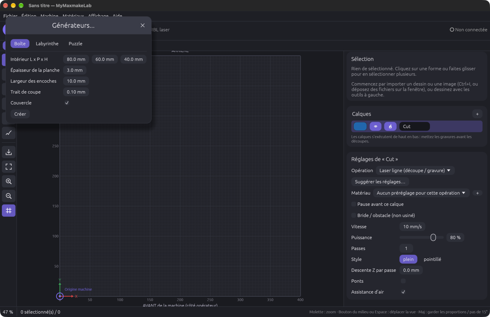

[← 3D, 4 et 5 axes](06-3d-multi-axes.md) · [Sommaire](README.md) · [Machines et connexion →](08-machines.md)

# 7. Générateurs

**Édition › Générateurs…**

| Générateur | Réglages |
|---|---|
| **Boîte à encoches** | dimensions intérieures (l'objet + 1 à 2 mm de jeu), épaisseur de planche, largeur des encoches, trait de coupe, couvercle |
| **Boîte ronde** | dimensions intérieures, rayon des coins, épaisseur, pas de la charnière, fermée ou non : la paroi est une seule bande pliée grâce à une charnière flexible, fond et dessus tenus par des tenons |
| **Labyrinthe** | cases, taille d'une case, *murs* (à graver ou découper) ou *couloirs* (à fraiser pour un labyrinthe à bille), solution |
| **Puzzle** | taille, nombre de pièces, taille des tenons, nouvelle variante ; ou **dans la forme sélectionnée** |
| **Grille de test laser** | plages de puissance et de vitesse, nombre de cases |
| **Engrenage** | nombre de dents, module, angle de pression (14,5°, 20° ou 25°), alésage, jeu |
| **QR / code-barres** | QR code ou Code 128, contenu, largeur, hauteur des barres, mode inversé |

Deux engrenages de même module s'engrènent : leur entraxe vaut la somme de
leurs diamètres primitifs divisée par deux (affichés sous les réglages). Le
QR code et le code-barres arrivent sur un calque de **remplissage** ; le mode
*inversé* grave les parties claires, pour les matériaux sombres qui
blanchissent au laser (aluminium anodisé, ardoise).

Les encoches de la boîte sont toujours en nombre impair, ce qui rend tous
les angles cohérents ; les panneaux sont agrandis de la moitié du trait de
coupe pour un assemblage serré sans colle.

**Puzzle dans une forme** : sélectionnez une forme fermée (cœur,
silhouette, texte épais, dessin importé…) puis **Puzzle…** dans le panneau
Sélection, ou cochez *Dans la forme sélectionnée* dans le générateur. La
grille de pièces couvre la forme, les coupes sont gardées à l'intérieur et
le contour devient le bord ; la forme est remplacée par le puzzle (une
seule annulation). La grille est placée pour éviter les toutes petites
pièces le long du bord, et celles qui restent trop petites (moins de 30 %
d'une pièce normale) sont réunies à leur voisine.

**Puzzle sur traits** (puzzle pour enfants) : sélectionnez un dessin
(vecteurs, ou une image : dessin scanné, coloriage, personnage en aplats)
puis **Puzzle sur traits…** dans le panneau Sélection. Les traits au moins
aussi épais que le seuil deviennent les coupes entre pièces, le contour du
dessin fait le bord ; les traits plus fins (yeux, détails) restent du
dessin à graver, et les grandes zones foncées (aplats) deviennent des
pièces à part entière. Une zone plus petite que la *pièce minimale*
rejoint sa voisine. En option, un **plateau** rectangulaire autour, à
découper dans la même planche pour y encastrer les pièces ; le dessin
vectoriel passe sur un calque *Gravure* exécuté avant les découpes.
Le seuil dépend de la taille du dessin : réduit à 90 mm de large, un
contour de dessin animé ne fait plus que 0,6 à 1 mm. Pour une image, le
seuil est **mesuré automatiquement** sur ses contours à la sélection
(bouton **Mesurer** pour recommencer après un changement de taille) :
chaque contour noir devient une coupe, et la *pièce minimale* fait le
tri entre les pièces et les détails. Les zones claires mais colorées
(peau, objets pâles) font partie du dessin ; une petite marque isolée,
comme une signature, reste gravée sans être découpée.

## Projets exemples

**Fichier › Projets exemples…** (ou le panneau de démarrage) : des projets
prêts à usiner, chacun avec son **guide pas à pas** dans le panneau de
droite : matériel, outils, puis une étape par outil et par matériau, et
l'assemblage.

| Projet | Machine | Contenu |
|---|---|---|
| Pièce de calibration CNC | CNC | poches, trous, contour et règle de cotes connues, à mesurer pour régler la machine (pas par mm, jeu, diamètre de fraise) |
| Réglages laser | laser | grille puissance × vitesse, peigne de fentes (emboîtement), bande de 10 carrés pour mesurer la largeur du trait |
| Labyrinthe à bille | CNC | couloirs à la fraise de 6 mm, contour, couvercle en plexiglas |
| Tour de Hanoï | CNC | socle et sept disques en contreplaqué de 12 mm |
| Pentominos | laser | 12 pièces gravées et leur plateau 6 × 10 |
| Taquin | laser | 15 carreaux numérotés et leur cadre |
| Sous-verres | laser | quatre motifs gravés (viking, celte, japonais, art déco) |
| Décorations de Noël | laser | étoiles, boules gravées, flocons |
| Plaque de porte | CNC | mot sculpté à la fraise en V, filet, contour |
| Horloge à balancier | CNC | toutes les pièces d'une horloge murale à poids : platines, rouage (5 × 4 × 3), échappement à ancre de Graham, tambour à rochet, minuterie, cadran, aiguilles, balancier de 56 cm |

Dans le guide, **Préparer cette étape** ne garde actifs que les calques
de l'étape : le travail ne contient qu'un outil et qu'un matériau. Un
changement de fraise est donc toujours une nouvelle étape, avec un
nouveau palpage du Z (jamais une pause au milieu d'un travail, où le
zéro serait faux). L'étape en cours reste affichée dans l'onglet
Machine, avec un bouton pour préparer la suivante. Les pièces
nombreuses sont réparties sur des planches de 260 × 180 mm (la course
de la HiMill), une étape par planche ; le rectangle gris « Planche »
montre où poser le brut. Choisissez le placement « Zéro machine » pour
que toutes les étapes restent alignées.

Les avances et puissances sont des valeurs de départ (petite CNC dans
le contreplaqué, laser diode d'environ 10 W) : réglez-les avec les deux
projets de test. L'horloge est calculée mais n'a pas encore été
construite : ses palettes d'ancre sont à ajuster à la lime.

## Motifs par style

**Édition › Générer un motif…** : viking, celte, africain, maya / aztèque,
grec, japonais, art déco, polynésien, islamique ; en **frises** ou en
**pavage** ; **Nouvelle variante** tire une autre combinaison, le numéro de
variante permet de la retrouver.

## Grappe (pièces dans un cadre)

**Édition › Grappe…** range les pièces sélectionnées en rangées dans un
cadre, comme une maquette ou une planche de puzzle 3D, et active les
**ponts** (laser) ou les **attaches** (CNC) placés automatiquement. Le
cadre est sur son propre calque, découpé en dernier.

---

[← 3D, 4 et 5 axes](06-3d-multi-axes.md) · [Sommaire](README.md) · [Machines et connexion →](08-machines.md)
