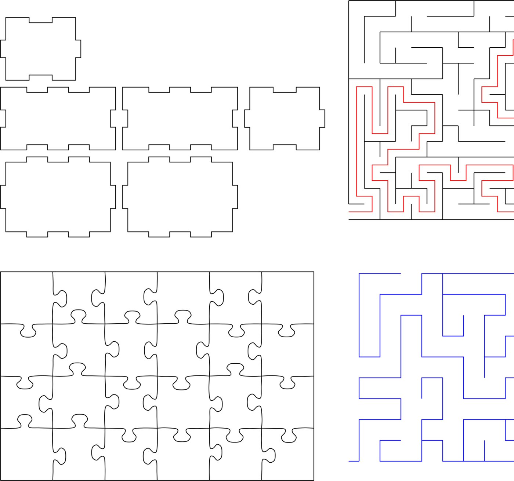
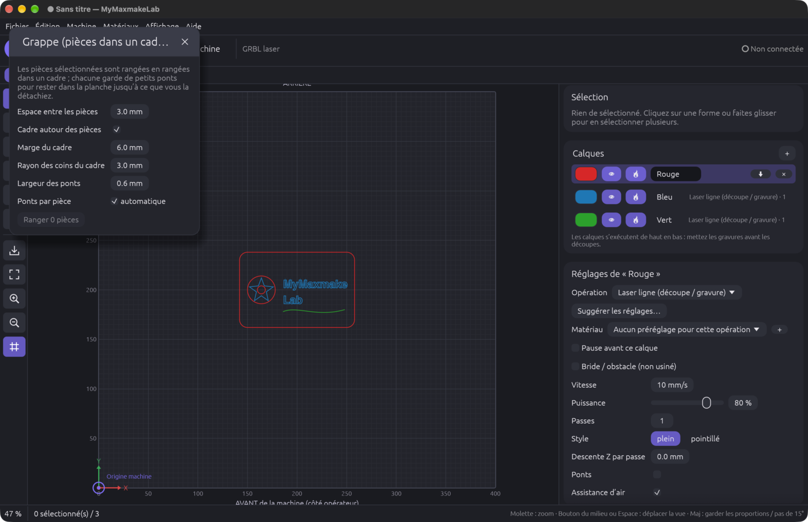

[← 3D, 4 et 5 axes](06-3d-multi-axes.md) · [Sommaire](README.md) · [Machines et connexion →](08-machines.md)

# 7. Générateurs

**Édition › Générateurs…**

| Générateur | Réglages |
|---|---|
| **Boîte à encoches** | dimensions intérieures (l'objet + 1 à 2 mm de jeu), épaisseur de planche, largeur des encoches, trait de coupe, couvercle |
| **Labyrinthe** | cases, taille d'une case, *murs* (à graver ou découper) ou *couloirs* (à fraiser pour un labyrinthe à bille), solution |
| **Puzzle** | taille, nombre de pièces, taille des tenons, nouvelle variante |

Les encoches de la boîte sont toujours en nombre impair, ce qui rend tous
les angles cohérents ; les panneaux sont agrandis de la moitié du trait de
coupe pour un assemblage serré sans colle.

## Motifs par style

**Édition › Générer un motif…** : viking, celte, africain, maya / aztèque,
grec, japonais, art déco, polynésien, islamique ; en **frises** ou en
**pavage** ; **Nouvelle variante** tire une autre combinaison, le numéro de
variante permet de la retrouver.

## Grappe (pièces dans un cadre)

**Édition › Grappe…** range les pièces sélectionnées en rangées dans un
cadre, comme une maquette ou une planche de puzzle 3D, et active les
**ponts** (laser) ou les **attaches** (CNC) placés automatiquement. Le
cadre est sur son propre calque, découpé en dernier.

---

[← 3D, 4 et 5 axes](06-3d-multi-axes.md) · [Sommaire](README.md) · [Machines et connexion →](08-machines.md)
