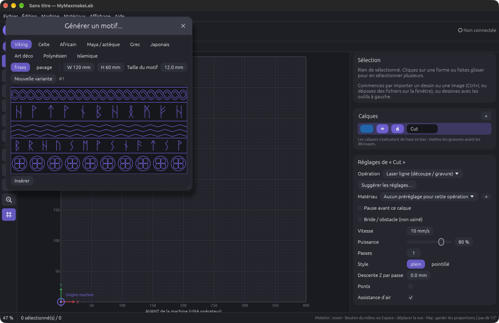

[← 3D, 4 et 5 axes](06-3d-multi-axes.md) · [Sommaire](README.md) · [Machines et connexion →](08-machines.md)

# 7. Générateurs

**Édition › Générateurs…**

| Générateur | Réglages |
|---|---|
| **Boîte à encoches** | dimensions intérieures (l'objet + 1 à 2 mm de jeu), épaisseur de planche, largeur des encoches, trait de coupe, couvercle |
| **Boîte ronde** | dimensions intérieures, rayon des coins, épaisseur, pas de la charnière, fermée ou non : la paroi est une seule bande pliée grâce à une charnière flexible, fond et dessus tenus par des tenons |
| **Labyrinthe** | cases, taille d'une case, *murs* (à graver ou découper) ou *couloirs* (à fraiser pour un labyrinthe à bille), solution |
| **Puzzle** | taille, nombre de pièces, taille des tenons, nouvelle variante ; ou **dans la forme sélectionnée** |
| **Grille de test laser** | plages de puissance et de vitesse, nombre de cases |
| **Engrenage** | nombre de dents, module, angle de pression (14,5°, 20° ou 25°), alésage, jeu |
| **QR / code-barres** | QR code ou Code 128, contenu, largeur, hauteur des barres, mode inversé |

Deux engrenages de même module s'engrènent : leur entraxe vaut la somme de
leurs diamètres primitifs divisée par deux (affichés sous les réglages). Le
QR code et le code-barres arrivent sur un calque de **remplissage** ; le mode
*inversé* grave les parties claires, pour les matériaux sombres qui
blanchissent au laser (aluminium anodisé, ardoise).

Les encoches de la boîte sont toujours en nombre impair, ce qui rend tous
les angles cohérents ; les panneaux sont agrandis de la moitié du trait de
coupe pour un assemblage serré sans colle.

**Puzzle dans une forme** : sélectionnez une forme fermée (cœur,
silhouette, texte épais, dessin importé…) puis **Puzzle…** dans le panneau
Sélection, ou cochez *Dans la forme sélectionnée* dans le générateur. La
grille de pièces couvre la forme, les coupes sont gardées à l'intérieur et
le contour devient le bord ; la forme est remplacée par le puzzle (une
seule annulation). La grille est placée pour éviter les toutes petites
pièces le long du bord, et celles qui restent trop petites (moins de 30 %
d'une pièce normale) sont réunies à leur voisine.

**Puzzle sur traits** (puzzle pour enfants) : sélectionnez un dessin
(vecteurs, ou une image : dessin scanné, coloriage, personnage en aplats)
puis **Puzzle sur traits…** dans le panneau Sélection. Les traits au moins
aussi épais que le seuil deviennent les coupes entre pièces, le contour du
dessin fait le bord ; les traits plus fins (yeux, détails) restent du
dessin à graver, et les grandes zones foncées (aplats) deviennent des
pièces à part entière. Une zone plus petite que la *pièce minimale*
rejoint sa voisine. En option, un **plateau** rectangulaire autour, à
découper dans la même planche pour y encastrer les pièces ; le dessin
vectoriel passe sur un calque *Gravure* exécuté avant les découpes.
Le seuil dépend de la taille du dessin : réduit à 90 mm de large, un
contour de dessin animé ne fait plus que 0,6 à 1 mm. Pour une image, le
seuil est **mesuré automatiquement** sur ses contours à la sélection
(bouton **Mesurer** pour recommencer après un changement de taille) :
chaque contour noir devient une coupe, et la *pièce minimale* fait le
tri entre les pièces et les détails. Les zones claires mais colorées
(peau, objets pâles) font partie du dessin ; une petite marque isolée,
comme une signature, reste gravée sans être découpée.

## Projets exemples

**Fichier › Projets exemples…** (ou le panneau de démarrage) : des projets
prêts à usiner, chacun avec son **guide pas à pas** dans le panneau de
droite : matériel, outils, puis une étape par outil et par matériau, et
l'assemblage.

| Projet | Machine | Contenu |
|---|---|---|
| Pièce de calibration CNC | CNC | poches, trous, contour et règle de cotes connues, à mesurer pour régler la machine (pas par mm, jeu, diamètre de fraise) |
| Réglages laser | laser | grille puissance × vitesse, peigne de fentes (emboîtement), bande de 10 carrés pour mesurer la largeur du trait |
| Alignement CNC / laser | CNC + laser | échelles fraisées et verniers gravés au laser : lisent au dixième de millimètre le « Décalage du laser » |
| Peigne d'ajustement CNC | CNC | encoches de 5,8 à 6,6 mm avec dégagements d'angle, trous pour tourillons de 6 et 8 mm au dixième |
| Labyrinthe à bille | CNC | couloirs à la fraise de 6 mm, contour, couvercle en plexiglas |
| Tour de Hanoï | CNC | socle et sept disques en contreplaqué de 12 mm |
| Dragon 3D à emboîter | laser | corps, ailes et deux paires de pattes à fentes croisées, écailles gravées |
| Tricératops 3D à emboîter | laser | corps, collerette et deux paires de pattes, peau gravée |
| Galion 3D à emboîter | laser | coque et mâts d'une pièce, deux voiles carrées enfilées sur les mâts, deux berceaux |
| Ours 3D et loup 3D à emboîter | laser | deux flancs (la silhouette complète, debout sur ses quatre pattes) tenus par trois entretoises bombées qui forment le dos |
| Rhinocéros 3D et tortue 3D | laser | mêmes flancs et entretoises que l'ours ; la tortue a une carapace bombée de 4 cm de large |
| Fusée 3D | laser | corps à hublots croisé avec l'étage d'ailerons, debout sur quatre ailerons |
| Avion 3D | laser | aile et empennage glissés à travers le fuselage, train d'atterrissage emboîté sous le ventre |
| Book nook : la ruelle | laser | boîte à créneaux à glisser entre les livres : façades en deux couches, passerelle à tenons traversants, pavés, guirlandes, ville au fond |
| Cale-livres forêt et cerfs | laser | montant, base et équerre à tenons, forêt et cerf découpés |
| Coffre à code (cryptex) | laser | quatre molettes à lettres, cames à encoche et pêne coulissant ; le code se choisit au collage |
| Squelette de T-rex | laser | colonne et crâne denté, huit côtes, bassin portant deux pattes de profil, bras, socle |
| Automate marin | laser | manivelle, arbre à trois cames, bateau, baleine et poisson qui montent et descendent entre trois rangées de vagues |
| Trébuchet | laser | bâtis en A, bras sur axe avec cales, contrepoids en boîte suspendu ; lance une boulette de papier |
| Grande roue | laser | deux roues à rayons et traverses, huit nacelles qui restent droites, bâtis en A, manivelle |
| Moulin à vent | laser | tour à créneaux et pierres gravées, toit en bardeaux, ailes en treillis qui tournent |
| Château fort | laser | murailles crénelées, quatre tours, pont-levis à charnière, herse coulissante |
| Sapin de Noël 3D | laser | deux sapins croisés, boules découpées, guirlandes gravées, étoile sur la pointe |
| Globe à lamelles | laser | sphère de 11 cm : 5 anneaux et 8 lamelles qui s'emboîtent |
| Awalé | CNC + laser | décor gravé au laser, douze trous et deux greniers creusés en cuvette à la fraise boule de 6 mm (les graines se ramassent du bout des doigts), contour à la fraise plate ; règles du jeu dans le guide |
| Pentominos | laser | 12 pièces gravées et leur plateau 6 × 10 |
| Taquin | laser | 15 carreaux numérotés et leur cadre |
| Élan en forêt, Ours au coucher de soleil, Chouette au clair de lune | laser | décors à couches : cinq ou six feuilles collées, la silhouette de l'animal encadre des montagnes, des sapins, un ciel découpé ; trous d'alignement et numéros gravés cachés |
| Baleine et fonds marins, Manchot sur la banquise | laser | décors à couches : banc de poissons, algues et corail ; aurores boréales, icebergs et manchots |
| Ville la nuit | laser | fenêtre en arc, six couches : lune, immeubles aux fenêtres découpées, arbres et réverbères |
| Hublot sur l'espace | laser | étoiles, planète à anneau, fusée et sa traînée, boulons gravés sur le cadre |
| Citrouille d'Halloween | laser | lune et chauves-souris, arbres morts, maison hantée et tombes |
| Boule de Noël à couches | laser | cinq couches rondes, étoiles, collines et sapins, cerf bondissant |
| Mandala à couches | laser | six disques festonnés, la même fleur élargie de 2 mm à chaque couche, en gradins |
| Sous-verres | laser | quatre motifs gravés (viking, celte, japonais, art déco) |
| Décorations de Noël | laser | étoiles, boules gravées, flocons |
| Plaque de porte | CNC | mot sculpté à la fraise en V, filet, contour |
| Vide-poche à rose des vents | CNC + laser | poche et contour à la fraise, rose des vents gravée au fond de la poche (mise au point 6 mm plus bas) |
| Toupies à illusions | CNC + laser | disque de Benham, spirale et anneaux gravés au laser, axes et disques à la fraise |
| Cadran solaire horizontal | CNC + laser | lignes d'heures calculées pour 47° N gravées au laser, cadran, style et fente à la fraise |
| Médaillons de géométrie sacrée | laser | fleur de vie, cube de Métatron, arbre de vie |
| Pierres de runes | CNC | les 24 runes du futhark ancien à la fraise en V sur des palets, plus une rune blanche |
| Médaillons en relief | CNC | soleil, triple lune, rosace à six pétales et arbre de vie qui ressortent, bombés, d'un fond creusé à la fraise boule, dans du bois dur |
| Planche de spiritisme | laser | alphabet en arc, chiffres, oui / non / au revoir dans la langue du guide, et sa goutte |
| Horloge à balancier | CNC | toutes les pièces d'une horloge murale à poids : platines, rouage (5 × 4 × 3), échappement à ancre de Graham, tambour à rochet, minuterie, cadran, aiguilles, balancier de 56 cm |

Les puzzles 3D et les décors à couches découpés au laser sont
**redimensionnables** : à l'ouverture, choisissez l'épaisseur du
contreplaqué, la planche (format des projets, A4, A5, A6 ou
personnalisée) et la taille. Le dessin est mis à l'échelle, mais les
fentes gardent la largeur de l'épaisseur et les trous d'alignement 2 mm ;
les pièces sont réparties sur des planches de ce format. La fenêtre
propose la plus grande taille qui tient sur la planche et refuse une
planche plus grande que la zone de travail de la machine. Le guide indique
l'épaisseur, le nombre de planches et l'échelle choisis.

Les silhouettes d'animaux de ces projets viennent de dessins du domaine
public (CC0) d'Openclipart, listés dans `crates/mml_samples/art/CREDITS.md`.

Dans le guide, **Préparer cette étape** ne garde actifs que les calques
de l'étape : le travail ne contient qu'un outil et qu'un matériau. Un
changement de fraise est donc toujours une nouvelle étape, avec un
nouveau palpage du Z (jamais une pause au milieu d'un travail, où le
zéro serait faux). L'étape en cours reste affichée dans l'onglet
Machine, avec un bouton pour préparer la suivante. Les pièces
nombreuses sont réparties sur des planches de 260 × 180 mm (la course
de la HiMill), une étape par planche ; le rectangle gris « Planche »
montre où poser le brut. Choisissez le placement « Zéro machine » pour
que toutes les étapes restent alignées.

Les projets **CNC + laser** demandent une CNC avec module laser (cochez
« Mode laser » dans **Machine › Réglages de la machine…**). Chaque étape
n'utilise qu'une tête ; le guide détaille le changement de tête, le
passage du contrôleur en mode laser ou fraisage, le homing à refaire et
la mise au point. La planche ne bouge pas d'un bout à l'autre : réglez
d'abord le « Décalage du laser » avec le projet d'alignement, pour que
la gravure tombe pile sur l'usinage.

Les avances et puissances sont des valeurs de départ (petite CNC dans
le contreplaqué, laser diode d'environ 10 W) : réglez-les avec les deux
projets de test. L'horloge est calculée mais n'a pas encore été
construite : ses palettes d'ancre sont à ajuster à la lime.

## Motifs par style

**Édition › Générer un motif…** : viking, celte, africain, maya / aztèque,
grec, japonais, art déco, polynésien, islamique ; en **frises** ou en
**pavage** ; **Nouvelle variante** tire une autre combinaison, le numéro de
variante permet de la retrouver.

## Grappe (pièces dans un cadre)

**Édition › Grappe…** range les pièces sélectionnées en rangées dans un
cadre, comme une maquette ou une planche de puzzle 3D, et active les
**ponts** (laser) ou les **attaches** (CNC) placés automatiquement. Le
cadre est sur son propre calque, découpé en dernier.

---

[← 3D, 4 et 5 axes](06-3d-multi-axes.md) · [Sommaire](README.md) · [Machines et connexion →](08-machines.md)
