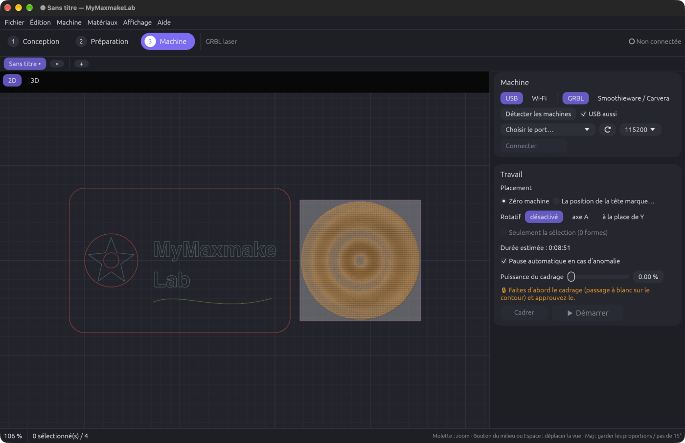
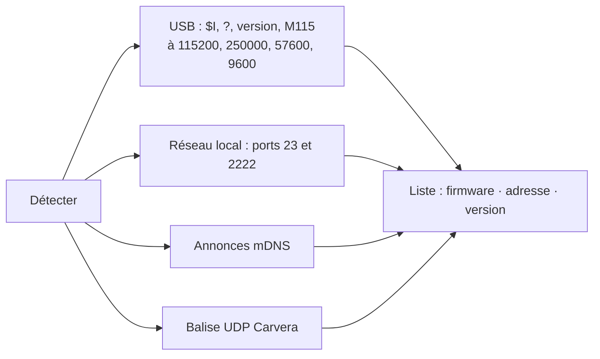
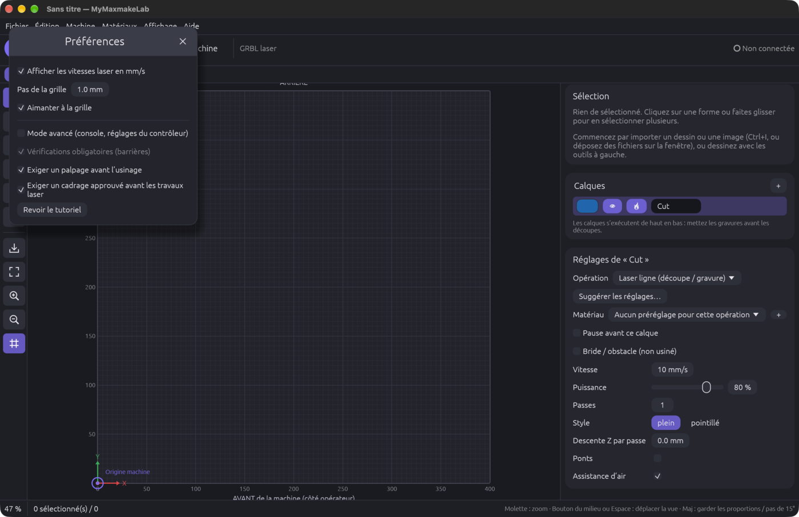
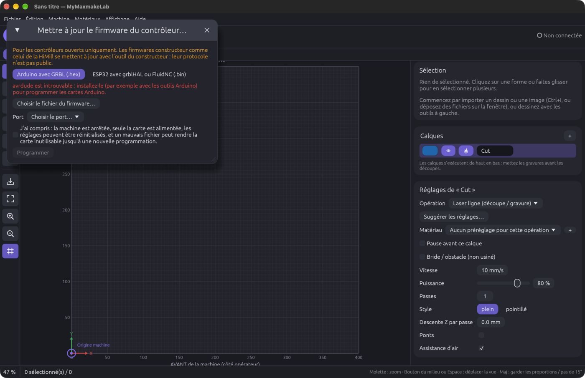

[← Générateurs](07-generateurs.md) · [Sommaire](README.md) · [Sécurité →](09-securite.md)

# 8. Machines et connexion

## Se connecter

- **USB** : choisissez le port et la vitesse (115200 par défaut).
- **Wi-Fi** : adresse et port (telnet 23 pour GRBL Wi-Fi, ESP3D, FluidNC et
  la HiMill ; 2222 pour la Carvera).
- **Protocole** : *GRBL* (comptage de caractères, le plus rapide) ou
  *Smoothieware / Carvera* (chaque ligne attend son acquittement).

## Détecter les machines

**Détecter les machines** interroge les ports USB à plusieurs vitesses et
cherche sur le réseau local, puis reconnaît le firmware : GRBL, grblHAL,
FluidNC, Smoothieware, Makera Carvera, Marlin. Un clic remplit la connexion
et le protocole.

> Ouvrir un port USB redémarre la plupart des cartes Arduino : décochez
> *USB aussi* si une autre machine en USB travaille (imprimante 3D en cours
> d'impression).

## Profils de machine

*Machine › Réglages de la machine* : nom, laser ou CNC, taille du plateau,
course Z, coin d'origine, valeur S de pleine puissance (`$30`), mode laser
(`M4`), hauteur de sécurité, scripts de début et de fin, **changeur
d'outils**, **plateau 5 axes**, **diamètre de l'écrou de pince** et
**capteur d'outil** (voir [Sécurité](09-securite.md)).

Le script de fin s'exécute en tout dernier, après le retour de l'outil
(broche et arrosage déjà coupés), juste avant `M2`.

À la connexion, la taille du plateau et la course Z prennent les valeurs
du contrôleur (`$130` à `$132`) : la grille correspond à l'espace de travail
réel. Option *Prendre la course du contrôleur* pour le désactiver.

### Maxmake HiMill D1S

Profil prêt dans le menu **Machine** : 280 × 200 × 80 mm, broche à 13 000
(`$30`), origine à l'**arrière gauche** du plateau : la broche est à gauche
et le plateau mobile tout avancé vers vous, donc l'outil au-dessus de
l'arrière du plateau. Comme MaxmakeLAB, chaque programme est encadré par
`[STREAM_START]` et `[STREAM_END]`, commandes du firmware HiMill (qui se
présente sous le nom GCARVIN) ; une reprise de travail les réémet.

### Laser et broche sur la même machine (HiMill)

Le module laser n'est pas sur l'axe de la broche. *Décalage du laser* (dans
les réglages d'une CNC dont le mode laser est activé) indique où tombe le
point laser par rapport à la broche ; les calques laser sont déplacés
d'autant, si bien qu'une gravure et un fraisage du même dessin tombent au
même endroit. Pour le mesurer : gravez un point au laser, amenez la pointe
d'une fraise exactement dessus, et entrez la différence de position.

## Déplacer la tête

La carte **Déplacer la tête** de l'étape Machine a un pavé de flèches, Z+
et Z−. Un clic ou un appui bref avance d'un pas ; maintenu plus de 0,3 s,
la tête avance jusqu'au relâchement.

**Précision** : Micro (0,01 mm), Fin (0,1), Normal (1), Rapide (10), Très
rapide (50). Le niveau règle le pas et la vitesse quand on maintient : en
Micro et Fin la tête avance lentement et s'arrête pile.

| Clavier | Action |
|---|---|
| `←` `→` `↑` `↓` | X et Y (deux flèches : diagonale) |
| `Page ↑` / `Page ↓` | Z |
| `1` … `5` | niveau de précision |
| `+` / `−` | niveau plus grossier / plus fin |
| `⇧` / `⌥` maintenus | un niveau plus grossier / plus fin le temps de l'appui |

Relâcher une touche arrête toujours la tête, même si l'on change d'onglet
entre-temps.

Après un homing réussi, les déplacements s'arrêtent aux bouts de course :
l'application connaît alors l'espace machine (position de homing, sens de
homing `$23`, course `$130` à `$132`). Avant le homing, un déplacement est
seulement limité à une course d'axe. Rappel : **Y+ va vers l'arrière** ;
pour ramener la tête (ou l'outil, sur un plateau mobile) vers vous, c'est
la flèche du bas (Y−).

**Broche** (fraiseuse) : *Faire tourner* démarre la broche à la vitesse
choisie et attend 3 s qu'elle soit lancée. Faites tourner la fraise avant
d'approcher la matière : au contact elle coupe un peu au lieu de casser.
Cela permet aussi d'usiner à la main avec les flèches. Tant que la broche
tourne, les déplacements sont limités à 1000 mm/min (300 mm/min en
descente). Un travail, un arrêt ou un arrêt d'urgence reprennent la main
sur la broche.

## Réglages du contrôleur et mode avancé

Le **mode avancé** (préférences) affiche la console, les macros et
l'éditeur des réglages `$$` avec leurs explications. Seul ce mode permet
de lever les verrous de démarrage ; la surveillance en direct reste active.

## Makera Carvera

Découverte Wi-Fi, changeur d'outils (`M6 T…`), raisons d'arrêt expliquées
(échec du changeur, capot ouvert, broche trop chaude…), outil en broche
affiché.

## Mise à jour du firmware

En mode avancé, *Machine › Firmware* flashe GRBL sur Arduino (`avrdude`) ou
grblHAL / FluidNC sur ESP32 (`esptool`), avec confirmation des risques et
journal en direct. Le firmware constructeur de la HiMill n'est pas pris en
charge (protocole non public).

---

[← Générateurs](07-generateurs.md) · [Sommaire](README.md) · [Sécurité →](09-securite.md)
