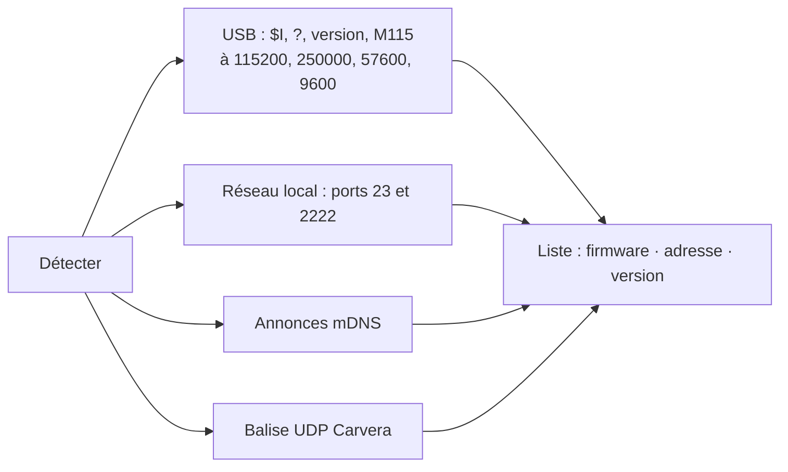

[← Générateurs](07-generateurs.md) · [Sommaire](README.md) · [Sécurité →](09-securite.md)

# 8. Machines et connexion

## Se connecter

- **USB** : choisissez le port et la vitesse (115200 par défaut).
- **Wi-Fi** : adresse et port (telnet 23 pour GRBL Wi-Fi, ESP3D, FluidNC et
  la HiMill ; 2222 pour la Carvera).
- **Protocole** : *GRBL* (comptage de caractères, le plus rapide) ou
  *Smoothieware / Carvera* (chaque ligne attend son acquittement).

## Détecter les machines

**Détecter les machines** interroge les ports USB à plusieurs vitesses et
cherche sur le réseau local, puis reconnaît le firmware : GRBL, grblHAL,
FluidNC, Smoothieware, Makera Carvera, Marlin. Un clic remplit la connexion
et le protocole.

> Ouvrir un port USB redémarre la plupart des cartes Arduino : décochez
> *USB aussi* si une autre machine en USB travaille (imprimante 3D en cours
> d'impression).

## Profils de machine

*Machine › Réglages de la machine* : nom, laser ou CNC, taille du plateau,
course Z, coin d'origine, valeur S de pleine puissance (`$30`), mode laser
(`M4`), hauteur de sécurité, scripts de début et de fin, **changeur
d'outils**, **plateau 5 axes**, **diamètre de l'écrou de pince** et
**capteur d'outil** (voir [Sécurité](09-securite.md)).

## Réglages du contrôleur et mode avancé

Le **mode avancé** (préférences) affiche la console, les macros et
l'éditeur des réglages `$$` avec leurs explications. Seul ce mode permet
de lever les verrous de démarrage ; la surveillance en direct reste active.

## Makera Carvera

Découverte Wi-Fi, changeur d'outils (`M6 T…`), raisons d'arrêt expliquées
(échec du changeur, capot ouvert, broche trop chaude…), outil en broche
affiché.

## Mise à jour du firmware

En mode avancé, *Machine › Firmware* flashe GRBL sur Arduino (`avrdude`) ou
grblHAL / FluidNC sur ESP32 (`esptool`), avec confirmation des risques et
journal en direct. Le firmware constructeur de la HiMill n'est pas pris en
charge (protocole non public).

---

[← Générateurs](07-generateurs.md) · [Sommaire](README.md) · [Sécurité →](09-securite.md)
