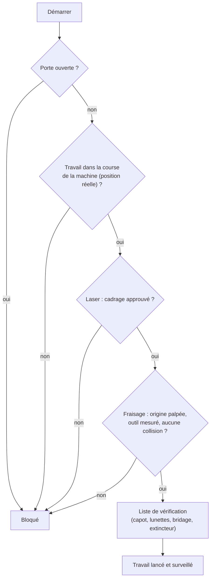
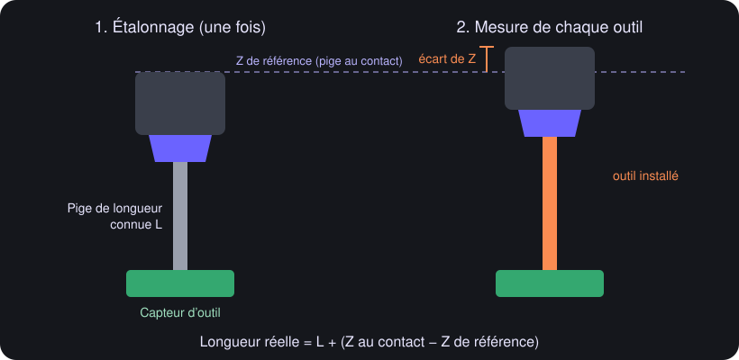
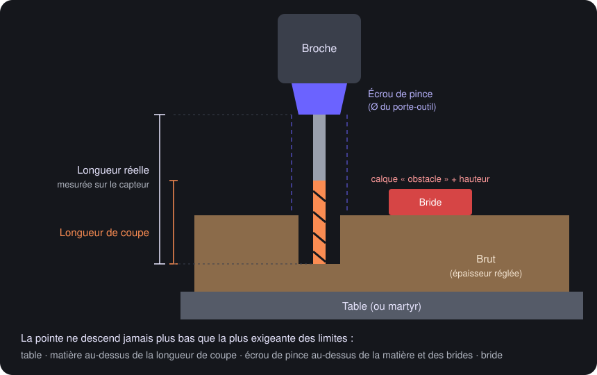
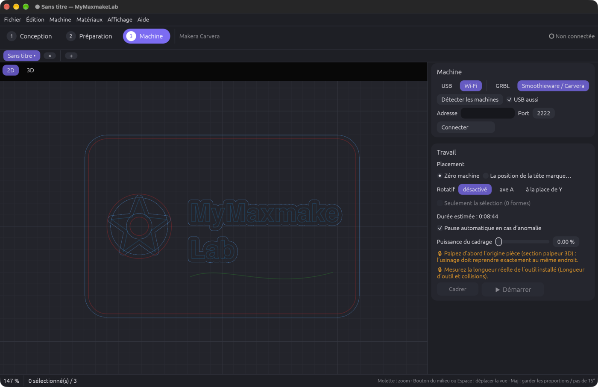

[← Machines et connexion](08-machines.md) · [Sommaire](README.md) · [Palpage et caméra →](10-palpage-camera.md)

# 9. Sécurité

La sécurité de l'opérateur et de la machine passe avant tout : des
**verrous de démarrage**, une **surveillance en direct**, et des calculs qui
empêchent les collisions.

> L'arrêt d'urgence logiciel ne remplace jamais l'arrêt d'urgence physique.

## Avant de démarrer

## Longueur réelle d'outil et collisions

La sécurité du fraisage repose sur la **longueur réelle de l'outil une fois
installé**, mesurée sur la machine, et non sur une valeur théorique.

1. **Étalonnage, une fois par machine** : installez une pige (une tige ou un
   outil) dont vous avez mesuré la longueur sortie au pied à coulisse,
   placez-vous au-dessus du capteur d'outil, *Étalonner le capteur… ›
   Palper le capteur avec la pige*.
2. **Mesure de chaque outil installé** : *Mesurer l'outil installé*. La
   longueur réelle vaut la longueur de la pige plus l'écart de hauteur au
   contact.
   *Sans capteur d'outil* : **Relever à la main**. Descendez l'outil jusqu'au
   contact d'une référence fixe (cale vissée au plateau), avec la même
   feuille de papier pour la pige et pour chaque outil : son épaisseur
   s'annule.
3. La mesure est **oubliée à chaque pause du programme** (là où l'on change
   d'outil ou de tête) : elle est redemandée avant de repartir.

Avec cette longueur, la longueur de coupe, le diamètre de l'écrou de pince,
l'épaisseur du brut et les **obstacles** (brides, étau, gabarit dessinés
comme des formes sur un calque *Bride / obstacle* avec leur hauteur), la
profondeur permise est calculée **en chaque point** :

- le programme entier est vérifié avant le démarrage ; chaque collision est
  listée avec sa ligne, sa position, la profondeur en trop et sa cause
  (table, queue au-dessus de la coupe, écrou de pince, bride) ;
- la carte affiche **en direct** la profondeur permise sous la tête ;
- le démarrage est bloqué tant que l'outil n'est pas mesuré ou qu'une
  collision subsiste.

## Homing doux et surveillé

Les moteurs pas à pas ne sentent rien : pendant le homing, rien dans le
contrôleur ne détecte une main ou un objet sur le trajet. Le logiciel
limite donc ce qu'un obstacle subit :

- **bouton maintenu** : le homing ne continue que tant que vous maintenez
  le bouton en surveillant la machine. Le relâcher (ou appuyer sur Échap)
  réinitialise le contrôleur à l'instant. Désactivable en mode avancé
  seulement ;
- **durée limitée** : un homing qui dure un quart de plus que le plus lent
  des derniers est coupé, bien avant la limite de GRBL (1,5 fois la course) ;
- **vitesse** : une recherche rapide est signalée ; **Ralentir le homing**
  écrit 500 mm/min pour la recherche (`$25`) et 50 mm/min pour l'approche
  (`$24`), ce qui réduit fortement le choc.

La **force** de poussée, elle, dépend du courant des moteurs : elle se règle
sur les drivers (potentiomètre, ou courant de homing des drivers Trinamic
sous grblHAL), pas depuis le logiciel.

## Pendant le travail

| Surveillance | Réaction |
|---|---|
| La tête sort de la zone du programme | pause immédiate |
| L'axe rotatif tourne sans être commandé | pause |
| Un fin de course est actionné | pause |
| Plus de réponse du contrôleur depuis 1,5 s | alerte |
| Retour à l'origine 40 % plus lent que d'habitude | alerte (axe qui force, courroie détendue) |
| Caméra : tête vue loin de sa position | pause (voir [Palpage et caméra](10-palpage-camera.md)) |

**Arrêter** garde la position (pause puis réinitialisation) ; **Arrêt
d'urgence** est toujours visible.

### Reprendre un travail interrompu

Après un arrêt, une erreur ou une alarme, la carte **Travail interrompu**
propose la ligne de reprise : le mouvement sur lequel la tête se trouvait
réellement (le contrôleur accepte des lignes d'avance, la dernière ligne
reçue n'est donc pas la bonne). La ligne se modifie, et la position où la
machine se rendra est affichée. *Reprendre à cette ligne* passe par les
mêmes vérifications qu'un démarrage, puis :

- en fraisage, la fraise remonte à la hauteur de sécurité, se place, la
  broche démarre (3 s pour prendre sa vitesse) et redescend lentement à la
  profondeur ;
- au laser, la tête s'y rend laser éteint.

Unités, coordonnées de travail, arrosage et avance sont rétablis. Si la
machine a perdu sa position (alarme, coupure), refaites le homing et
l'origine avant de reprendre. Les programmes en coordonnées relatives ou
en temps inverse (4 axes continu) ne se reprennent pas.

## Ordinateur en veille et notifications

Pendant un travail, l'ordinateur ne se met **pas en veille** (une mise en
veille arrêterait la machine en plein travail). À la fin, une notification
système s'affiche et la fenêtre demande l'attention (Dock, barre des
tâches).

---

[← Machines et connexion](08-machines.md) · [Sommaire](README.md) · [Palpage et caméra →](10-palpage-camera.md)
