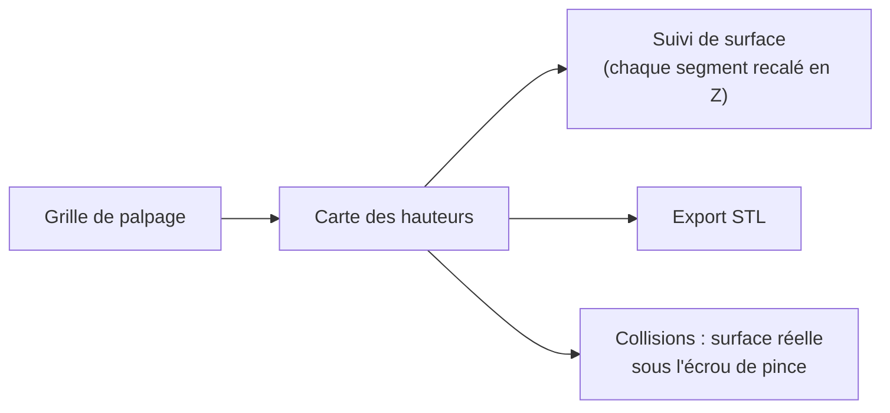

[← Sécurité](09-securite.md) · [Sommaire](README.md) · [Production, optimisation et coûts →](11-production-statistiques.md)

# 10. Palpage et caméra

## Origine par palpage

- **Z** sur une plaque de contact, ou **coin XYZ** sur un bloc de palpage.
- Le fraisage exige une origine palpée avant le démarrage (verrou
  désactivable en mode avancé).

## Surface plane inclinée ou surface irrégulière

| Mode | Principe |
|---|---|
| **Plat** | 3 à 9 points donnent le plan d'une face supérieure inclinée |
| **Irrégulier** | une grille de taille réglable mesure la surface, sans alarme là où rien n'est touché, et détecte la forme de la pièce |

Les travaux peuvent ensuite **suivre la surface** (compensation en Z) et le
laser peut augmenter sa puissance dans les pentes. La surface mesurée
s'exporte en **STL** pour Fusion 360.

## Caméra

- Une photo du plateau (téléphone, GoPro, Insta360…) ou un flux d'images
  depuis l'adresse d'une application de webcam.
- Cliquez une fois les **4 coins du plateau** : l'image redressée s'affiche
  à l'échelle sous le dessin, avec une opacité réglable.
- **Contrôle des mouvements** : l'application suit le point laser ou une
  pastille de couleur sur la tête, apprend l'écart constant entre la
  pastille et l'outil, et met en pause si la tête est vue trop loin de sa
  position annoncée trois fois de suite (pas perdus, courroie qui patine).

---

[← Sécurité](09-securite.md) · [Sommaire](README.md) · [Production, optimisation et coûts →](11-production-statistiques.md)
