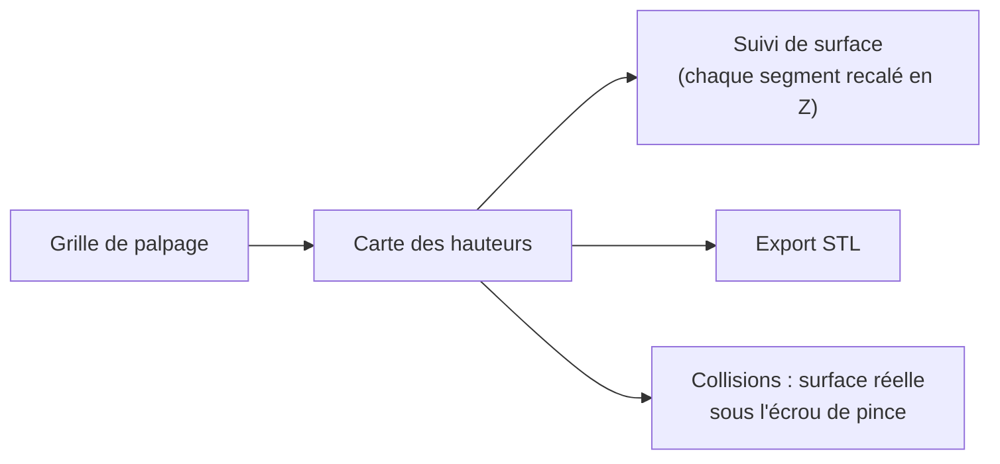
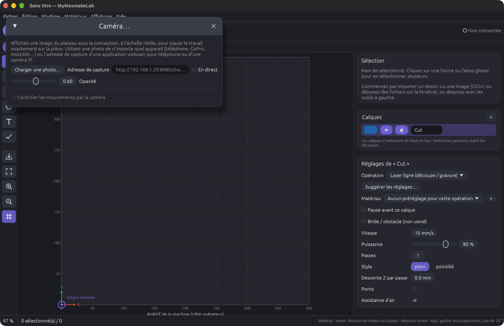

[← Sécurité](09-securite.md) · [Sommaire](README.md) · [Production, optimisation et coûts →](11-production-statistiques.md)

# 10. Palpage et caméra

## Origine par palpage

- **Z** sur une plaque de contact, ou **coin XYZ** sur un bloc de palpage.
- Le fraisage exige une origine définie avant le démarrage (palpeur ou
  relevé manuel ; verrou désactivable en mode avancé).
- Cochez **J'ai un palpeur 3D** pour afficher ces fonctions ; sans palpeur,
  elles sont masquées.

## Trouver un centre (palpeur)

**Trou ou poche** : placez le palpeur dans le trou, sous le bord ;
**tenon ou bloc** : placez-le au-dessus du milieu et indiquez la taille
approximative et la profondeur de touche. *Centrer en X et Y* touche deux
parois opposées en X, se place au milieu, recommence en Y, puis met
l'origine X/Y au centre et affiche les dimensions mesurées. Le cycle
convient aux formes rondes comme rectangulaires ; Z ne change pas.

## Relevé manuel, sans palpeur

Pas de palpeur 3D ? On approche l'outil pas à pas jusqu'au contact, puis
**Relever** enregistre la position de la machine. Chaque valeur peut aussi
être **saisie** à la main.

> **Astuce précision** : montez une **tige souple** (fil d'acier, foret
> retourné) à la place de la fraise, broche arrêtée, et descendez au pas de
> **0,01 mm**. Elle fléchit au contact sans marquer la pièce ni casser
> d'outil. On peut aussi glisser une feuille de papier (environ 0,1 mm) et
> s'arrêter quand elle frotte : indiquez son épaisseur comme *cale*.

| Forme | Points demandés | Ce qu'on obtient |
|---|---|---|
| Dessus seul | 1 : dessus | zéro Z |
| Dessus incliné | 3 (+1) sur le dessus | zéro Z, inclinaison suivie par le travail |
| Cube | 4 : dessus, gauche, avant, droite | origine, côté, hauteur |
| Pavé | 3 : dessus, gauche, avant (+ droite, arrière, plateau) | origine, puis largeur, profondeur, hauteur |
| Cylindre debout | 4 : dessus et 3 points du pourtour (+ plateau) | centre, diamètre |
| Cylindre couché (le long de X) | 4 : avant, arrière, dessus, bout gauche | axe, diamètre, hauteur |
| Trapèze (prisme le long de X) | 5 : dessus, gauche, pente avant en bas et en haut, pente arrière en bas | largeur du dessus, angle des flancs |
| Trou | 4 : surface autour, puis 3 points de la paroi, de l'intérieur | centre, diamètre |
| Poche rectangulaire | 5 : surface autour, puis les 4 parois de l'intérieur | centre, largeur, profondeur |

- Le rayon de ce qui touche et la cale sont compensés automatiquement.
- Un **second point sur la face avant** mesure si la pièce est tournée dans
  l'étau : au-delà de 0,2°, réalignez-la.
- **Définir l'origine pièce** écrit l'origine (G54, coin avant gauche ou
  centre) quelle que soit la position actuelle de la tête, reprend la
  hauteur mesurée pour le calcul des collisions, et transforme un dessus
  incliné en surface suivie.
- Le trapèze suppose deux flancs de même pente, plus large à la base.

## Surface plane inclinée ou surface irrégulière

| Mode | Principe |
|---|---|
| **Plat** | 3 à 9 points donnent le plan d'une face supérieure inclinée |
| **Irrégulier** | une grille de taille réglable mesure la surface, sans alarme là où rien n'est touché, et détecte la forme de la pièce |

Les travaux peuvent ensuite **suivre la surface** (compensation en Z) et le
laser peut augmenter sa puissance dans les pentes. La surface mesurée
s'exporte en **STL** pour Fusion 360.

## Caméra

- Une photo du plateau (téléphone, GoPro, Insta360…) ou un flux d'images
  depuis l'adresse d'une application de webcam.
- Cliquez une fois les **4 coins du plateau** : l'image redressée s'affiche
  à l'échelle sous le dessin, avec une opacité réglable.
- **Contrôle des mouvements** : l'application suit le point laser ou une
  pastille de couleur sur la tête, apprend l'écart constant entre la
  pastille et l'outil, et met en pause si la tête est vue trop loin de sa
  position annoncée trois fois de suite (pas perdus, courroie qui patine).

---

[← Sécurité](09-securite.md) · [Sommaire](README.md) · [Production, optimisation et coûts →](11-production-statistiques.md)
