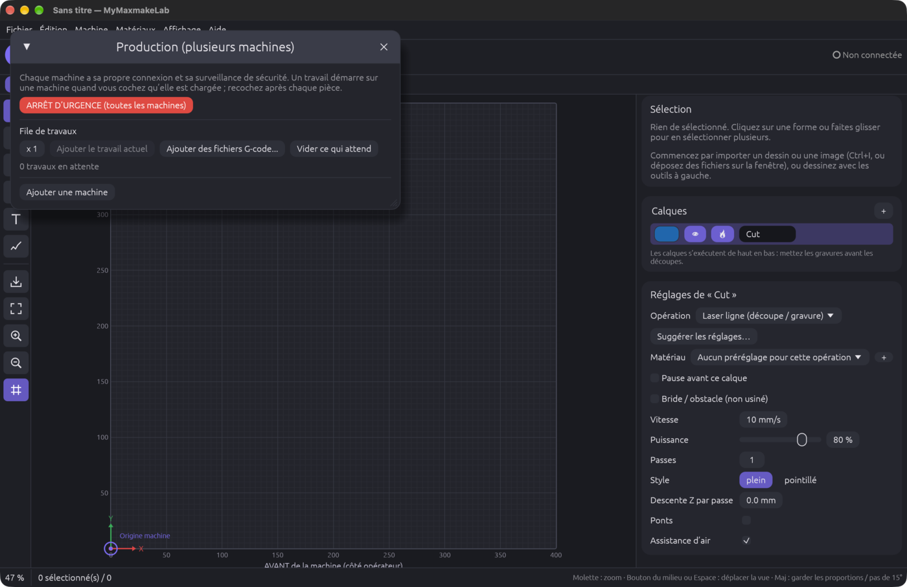
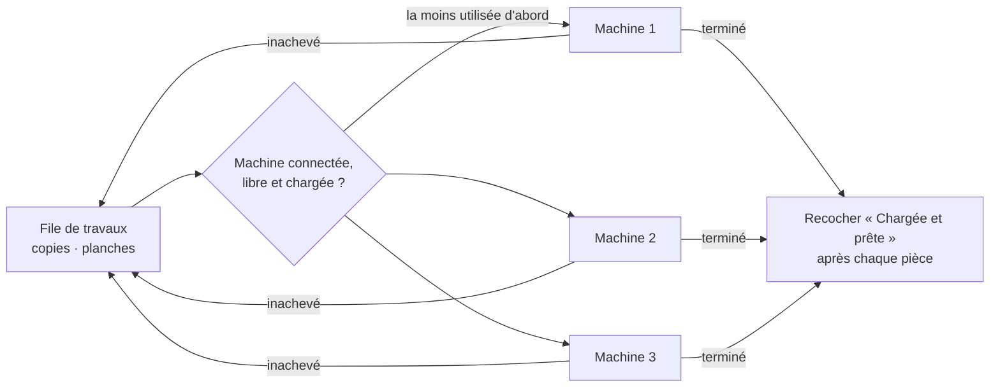
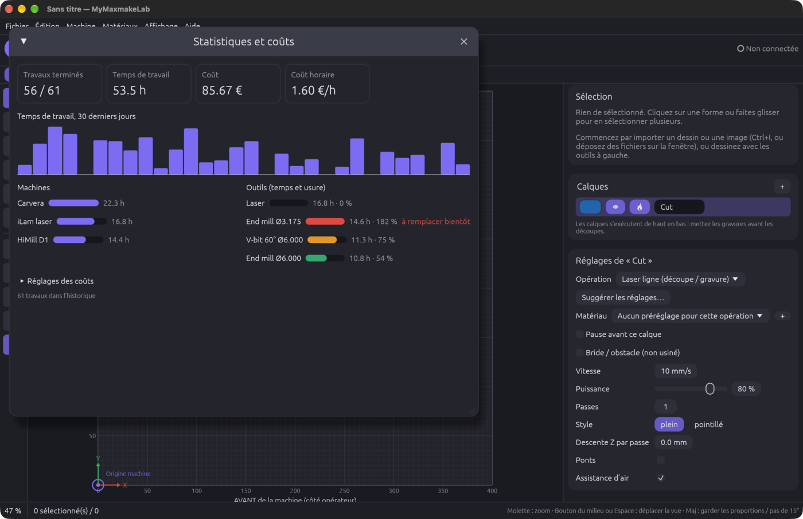

[← Palpage et caméra](10-palpage-camera.md) · [Sommaire](README.md) · [Assistants IA (MCP) →](12-assistants-ia.md)

# 11. Production, optimisation et coûts

## Plusieurs machines en parallèle

**Machine › Production (plusieurs machines)** : une file de travaux (copies
du travail actuel, fichiers G-code comme les planches d'un puzzle) partagée
entre des machines côte à côte.

- Chaque machine a sa connexion et sa surveillance de sécurité.
- Un travail ne démarre qu'après avoir coché **Chargée et prête** ; la case
  se décoche après chaque pièce.
- **Répartition équitable** : la machine la moins utilisée prend le travail
  suivant, pour partager l'usure.
- Un bouton d'**arrêt d'urgence** commun arrête toutes les machines.

## Suivre un travail depuis le téléphone

*Fichier › Appairer*, puis **Suivi du travail** : scannez le QR code avec un
téléphone ou une tablette du même réseau. La page affiche l'état de la
machine, le travail, l'avancement, le temps restant et la position, mises
à jour chaque seconde.

Elle ne propose que **Pause** et **Arrêt d'urgence** : depuis le réseau, un
travail ne peut jamais être lancé ni repris. Un code secret dans l'adresse
bloque les autres appareils du réseau.

## Optimiser

| Objectif | Comment |
|---|---|
| Gagner du temps | ordre des tracés amélioré (2-opt, Or-opt) : moins de déplacements à vide, trous toujours avant les contours |
| Alléger un programme | *Réparer et alléger* : commentaires, mots répétés, mouvements nuls, segments alignés fusionnés, avance manquante |
| Ménager la fraise et la machine | profils *Doux* et *Équilibré* (rampes, angles ralentis) |

## Statistiques et coûts

**Machine › Statistiques et coûts**

- Travaux terminés, temps de travail, coût, coût horaire, activité des 30
  derniers jours.
- Heures par machine, **temps et usure de chaque outil** ; la barre passe à
  l'orange puis au rouge avec « à remplacer bientôt ».
- **Coûts** : prix de la machine réparti sur sa durée de vie, puissance et
  prix de l'électricité, consommables par heure, main-d'œuvre, prix et
  durée de vie de chaque outil.
- En **Préparation**, le temps par outil et le coût estimé s'affichent avant
  de lancer le travail.
- **Durée apprise** : après deux travaux terminés sur une machine, la durée
  estimée (et le coût) est corrigée d'après l'écart réel des 10 derniers
  (médiane, entre ×0,5 et ×3). Le calcul seul ignore les accélérations sur
  les petits segments ou le démarrage de la broche ; une infobulle indique
  sur combien de travaux repose la correction.

L'historique est enregistré au fil de l'eau dans `usage.jsonl` (dossier de
réglages) : un plantage ne le perd pas.

---

[← Palpage et caméra](10-palpage-camera.md) · [Sommaire](README.md) · [Assistants IA (MCP) →](12-assistants-ia.md)
