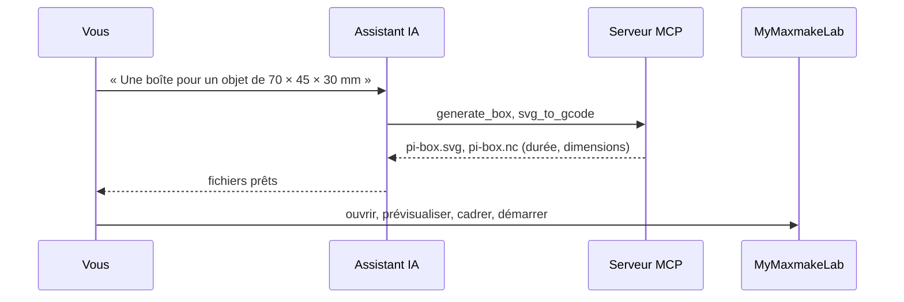

[← Production, optimisation et coûts](11-production-statistiques.md) · [Sommaire](README.md) · [Dépannage et questions fréquentes →](13-depannage.md)

# 12. Assistants IA (MCP)

Le serveur **MCP** fourni avec l'application permet à Claude, Codex (GPT),
Gemini ou à tout client MCP de créer boîtes, labyrinthes, puzzles, motifs et
textes, de transformer un SVG en G-code, de creuser un relief 3D et
d'analyser ou réparer un programme. Il **ne déplace jamais la machine** :
les programmes sont écrits dans des fichiers que vous ouvrez dans
MyMaxmakeLab pour les vérifier, cadrer et lancer.

**Aide › Assistants IA (MCP)** copie le chemin du serveur. La mise en place
pour chaque assistant (Claude Code, Claude Desktop, Codex, Gemini CLI,
Cursor, VS Code…) est décrite dans [MCP.md](../MCP.md).

---

[← Production, optimisation et coûts](11-production-statistiques.md) · [Sommaire](README.md) · [Dépannage et questions fréquentes →](13-depannage.md)
