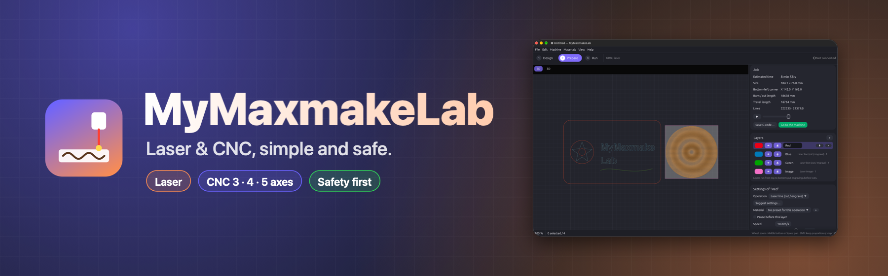

<div align="center">



# Manuel de MyMaxmakeLab

Laser et CNC, simplement et en sécurité : de l'idée à la pièce finie.

</div>

## Sommaire

| | Chapitre | Contenu |
|---|---|---|
| 1 | [Prise en main](01-prise-en-main.md) | installer, mises à jour automatiques, premier lancement, langues |
| 2 | [Interface](02-interface.md) | les trois étapes, repères du plateau, navigation, historique, vue 3D |
| 3 | [Conception](03-conception.md) | importer, dessiner, écrire, déformer, calques et opérations |
| 4 | [Gravure et découpe laser](04-laser.md) | lignes et ponts, remplissages, images, cylindres, cadrage |
| 5 | [Fraisage CNC](05-fraisage.md) | profils, poches, gravure en V, outils et suggestion, fraisage doux, moule |
| 6 | [3D, 4 et 5 axes](06-3d-multi-axes.md) | relief, meilleure orientation, tranches, 4 axes, 5 axes |
| 7 | [Générateurs](07-generateurs.md) | boîte, labyrinthe, puzzle, motifs par style, grappe |
| 8 | [Machines et connexion](08-machines.md) | connexion, détection, profils, mode avancé, Carvera, firmware |
| 9 | [Sécurité](09-securite.md) | verrous, longueur réelle d'outil, collisions, surveillance |
| 10 | [Palpage et caméra](10-palpage-camera.md) | origine, surface inclinée ou irrégulière, caméra |
| 11 | [Production, optimisation et coûts](11-production-statistiques.md) | plusieurs machines, optimisation, statistiques et coûts |
| 12 | [Assistants IA (MCP)](12-assistants-ia.md) | serveur MCP pour Claude, Codex, Gemini |
| 13 | [Dépannage et questions fréquentes](13-depannage.md) | machine muette, alarmes, démarrage bloqué, glossaire |

## Par où commencer

```mermaid
flowchart LR
    A["Nouveau ?"] --> B["1. Prise en main"]
    B --> C["2. Interface"]
    C --> DVotre machine
    D -- laser --> E["4. Laser"]
    D -- CNC --> F["5. Fraisage"]
    E --> G["9. Sécurité"]
    F --> G
    G --> H["Première pièce"]
```

| Je veux… | Aller à |
|---|---|
| graver une photo ou un texte au laser | [Laser](04-laser.md) |
| découper des pièces et les garder dans la planche | [Ponts](04-laser.md#laser-ligne) · [Grappe](07-generateurs.md#grappe-pièces-dans-un-cadre) |
| choisir la bonne fraise | [Suggestion d'outil](05-fraisage.md#bibliothèque-doutils-et-suggestion) |
| usiner une pièce 3D tout autour | [4 axes](06-3d-multi-axes.md#4-axes) |
| éviter toute collision | [Longueur réelle et collisions](09-securite.md#longueur-réelle-doutil-et-collisions) |
| produire en série sur plusieurs machines | [Production](11-production-statistiques.md) |
| connaître le coût d'une pièce | [Statistiques et coûts](11-production-statistiques.md#statistiques-et-coûts) |

<sub>Les captures montrent l'interface en français ; elle existe aussi en
anglais, allemand, italien et espagnol.</sub>
